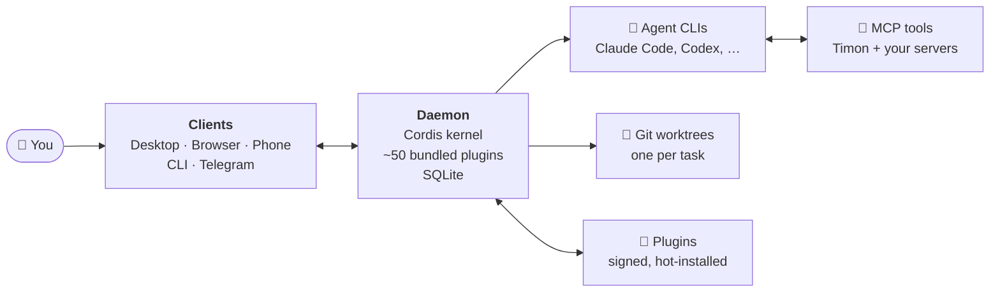

<p align="center">
  
</p>

<h1 align="center">Timon</h1>

<p align="center">
  <strong>Your AI agent team, running on your own machine.</strong><br />
  They work through the CLI subscriptions you already pay for, ship code that has been reviewed, and ask you before anything that matters.
</p>

<p align="center">
  <a href="LICENSING.md"></a>
  <a href="https://github.com/ai-timon/timon/releases"></a>
  <a href="https://github.com/ai-timon/timon/releases"></a>
  
  <a href="https://github.com/ai-timon/timon/stargazers"></a>
  <a href="https://discord.gg/ZQGARNcpZ3"></a>
  <a href="https://docs.timon-ai.com"></a>
</p>

<p align="center">
  <a href="#-quick-start"><strong>Download for Windows, macOS or Linux »</strong></a>
  <br />
  <br />
  <a href="https://docs.timon-ai.com">Docs</a>
  ·
  <a href="https://timon-ai.com">Website</a>
  ·
  <a href="https://discord.gg/ZQGARNcpZ3">Discord</a>
  ·
  <a href="CHANGELOG.md">Changelog</a>
  ·
  <a href="https://docs.timon-ai.com/plugins/overview">Write a plugin</a>
</p>

<br />

<p align="center"><strong>Your agents run on the CLI you already sign in to:</strong></p>
<p align="center">
  
  
  
  
  
  
  
  
  
</p>
<p align="center"><sub>your subscription, never a token-billed API · any ACP agent · add your own as a provider plugin</sub></p>

<br />

## 👋 Meet your agent team

You tell Timon what you need, in plain words. The **orchestrator** splits the job into tasks and
hands each one to the right agent: one codes, another reviews with a different model, a third
merges. Every agent has a role, its own skills and a memory that follows it from mission to
mission. You follow everything from one cockpit and step in whenever you want. They ask before
they push, publish or delete anything.

The team every project starts with:

<table>
  <tr>
    <td width="33%" valign="top">
      <strong>Orchestrator</strong><br />
      <sub>Plans the job, dispatches the tasks, keeps track of what is blocked</sub>
    </td>
    <td width="33%" valign="top">
      <strong>Coder</strong><br />
      <sub>Works in its own git worktree, runs the checks, commits step by step</sub>
    </td>
    <td width="33%" valign="top">
      <strong>Reviewer</strong><br />
      <sub>Reads the diff with another model and sends it back when it is not right</sub>
    </td>
  </tr>
  <tr>
    <td width="33%" valign="top">
      <strong>Merger</strong><br />
      <sub>Runs the full test suite once, then lands the branch</sub>
    </td>
    <td width="33%" valign="top">
      <strong>Researcher</strong><br />
      <sub>Digs through the code and the web, and turns an idea into a brief</sub>
    </td>
    <td width="33%" valign="top">
      <strong>Ops</strong><br />
      <sub>Handles the chores: dependencies, clean-ups, release notes</sub>
    </td>
  </tr>
</table>

<p align="center"><sub>Roles are fields, not names: rename them, add your own, import agents you already have.</sub></p>

## ✨ Features

**🧭 The orchestrator runs your team.** Describe the job, out loud if you like. It breaks it down,
lets you pick the models for each part on one screen, then dispatches and follows the work until
it lands.

<table>
  <tr>
    <td width="50%" valign="top">
      <strong>🔀 Code, review, merge</strong><br />
      <sub>Every task in its own worktree, reviewed by a second model before it lands</sub>
    </td>
    <td width="50%" valign="top">
      <strong>✋ You stay in charge</strong><br />
      <sub>Questions with buttons, permission cards, secrets the agent never sees</sub>
    </td>
  </tr>
  <tr>
    <td width="50%" valign="top">
      <strong>🌙 Work while you sleep</strong><br />
      <sub>Routines, cron and webhook triggers, overnight series paced to your quotas</sub>
    </td>
    <td width="50%" valign="top">
      <strong>🧩 Make it yours</strong><br />
      <sub>Widgets, pages, themes, layouts: signed plugins installed without a restart</sub>
    </td>
  </tr>
</table>

And everything else a team of agents needs:

- 🧠 **Memory that reaches the agent**: a rule learned once is injected into the next mission
- 🔁 **Missions that survive**: every turn and tool call is kept, a dead mission is resumed
- 🪂 **Quota fallbacks**: when one subscription runs dry, the work moves to the next backend
- 🌐 **A built-in browser**: isolated per mission, with annotations and recordings
- 🎙️ **Voice**: dictate a request, hear the answer
- 📱 **Reachable anywhere**: desktop app, browser, phone, Telegram, CLI, remote API
- 🖥️ **Three systems, one service**: Windows, macOS and Linux, running in the background

## 🚀 Quick start

<p align="center">
  <a href="https://github.com/ai-timon/timon/releases/latest"></a>
  <a href="https://github.com/ai-timon/timon/releases/latest"></a>
  <a href="https://github.com/ai-timon/timon/releases/latest"></a>
</p>

<p align="center"><sub>Windows 10+ (x64) · macOS 11+ (Apple silicon) · Linux x64, glibc 2.28+</sub></p>

You need one agent CLI already signed in: `claude`, `codex`, `copilot`, `grok`, `opencode`, `pi`
or `hermes-acp`. The installer brings its own Node.js, and on Windows installs Git when it is missing.

Once it is running, check that everything is in place:

```bash
timon doctor     # checks the service, the backends and the paths
timon backends   # lists the agent CLIs Timon found
```

That's it: open Timon and say hi to your orchestrator. 🎉

On a server without a screen, install the background service from the terminal:

```bash
timon service install --dry-run   # shows what will be installed
timon service install
```

The [installation guide](https://docs.timon-ai.com/installation/overview) covers each system,
remote access from your phone, updates and troubleshooting.

**From source.** Clone this repository and follow [GETTING-STARTED.md](GETTING-STARTED.md): the
daemon and the web app run on all three systems without the desktop app.

## 💳 Free or Pro?

Same app, same features. Pro adds what a team needs.

| | 🧑 Free | 👥 Pro |
|---|---|---|
| Agents, missions, Kanban, memory, routines | ✅ | ✅ |
| Every bundled module and every third-party plugin | ✅ | ✅ |
| Your CLI subscriptions, quota fallbacks | ✅ | ✅ |
| Desktop, browser, phone, Telegram, CLI | ✅ | ✅ |
| Several users, roles and groups, per-person permissions | | ✅ |
| Support | Community | ✅ |
| Price | Free | [See plans](https://timon-ai.com/pricing) |

<p align="center"><sub>A licence never replaces your CLI subscription, and Timon never calls a token-billed API on your behalf.</sub></p>

## 🧩 How it fits together



The daemon runs as a plain service on your machine (systemd, launchd or a Windows scheduled task)
and holds all the state. The clients hold none: close the app and your agents keep working.

**Built with** TypeScript, Node.js 22, [Cordis](https://github.com/deepseek-ai), SQLite, Next.js,
React, Tailwind and Electron.

## 🔌 Write a plugin

Product surfaces and third-party plugins are written the same way: a widget, a page, a theme, a
layout, a provider or a bundle of them. Start from a template, build against
[`@timon-ai/sdk`](https://www.npmjs.com/package/@timon-ai/sdk), publish on npm.

- [Plugin quickstart](https://docs.timon-ai.com/plugins/quickstart)
- [One template per kind](https://docs.timon-ai.com/plugins/examples)
- [SDK reference](https://docs.timon-ai.com/plugins/api-reference)

## 🤝 Community

Bug reports, translations and plugins are welcome.

- **Want to change the code?** Read [CONTRIBUTING.md](CONTRIBUTING.md): how to run the checks,
  and the rules a review looks at. Your first pull request asks you to sign the [CLA](CLA.md).
- **Found a bug?** [Open an issue](https://github.com/ai-timon/timon/issues/new/choose) with your
  version and the output of `timon doctor`. An issue without them is closed with a link to the guide.
- **Speak another language?** The interface is translated by pull request, without touching any
  code: see [CONTRIBUTING-TRANSLATIONS.md](CONTRIBUTING-TRANSLATIONS.md).
- **Found a vulnerability?** Report it privately, as [SECURITY.md](SECURITY.md) explains.
- Questions, plugins and show-and-tell go to [Discord](https://discord.gg/ZQGARNcpZ3).

If Timon saves you a few hours, a ⭐ helps a lot.

<p align="center">
  <a href="https://star-history.com/#ai-timon/timon&Date">
    <picture>
      <source media="(prefers-color-scheme: dark)" srcset="https://api.star-history.com/svg?repos=ai-timon/timon&type=Date&theme=dark">
      
    </picture>
  </a>
</p>

## 📜 License

Timon is free software under the [GNU AGPL v3](LICENSE), with an exception that leaves plugins
free to use any licence: [LICENSING.md](LICENSING.md) explains what that means for you. The SDK
and the plugin templates are under the MIT licence. The name, the logo and the mascot are not
covered by these licences: see [TRADEMARKS.md](TRADEMARKS.md). Third-party components are credited
in [THIRD_PARTY_NOTICES.md](THIRD_PARTY_NOTICES.md).
