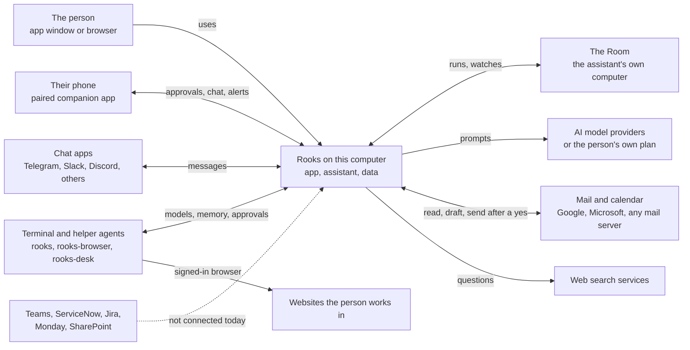
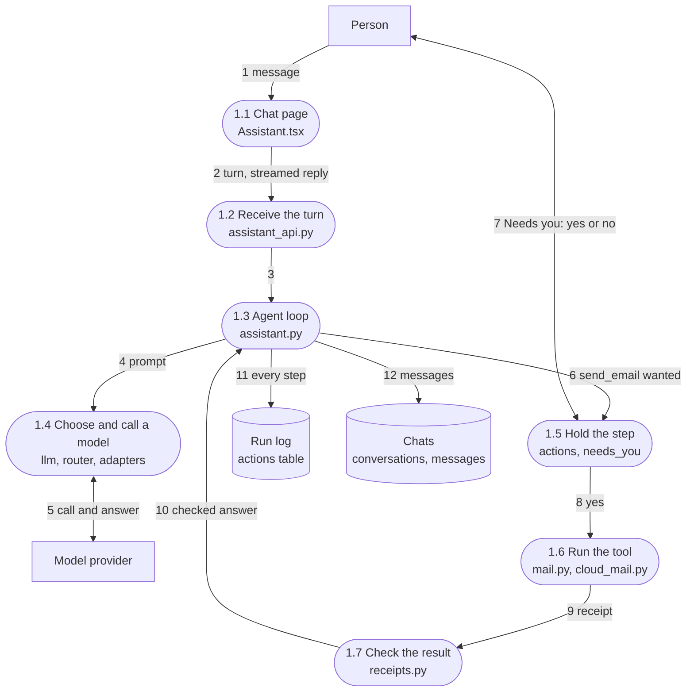
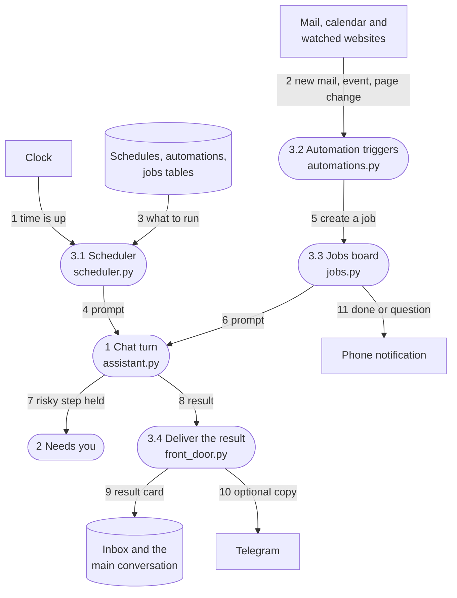
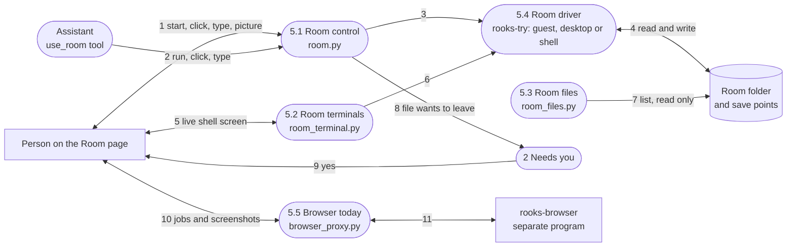
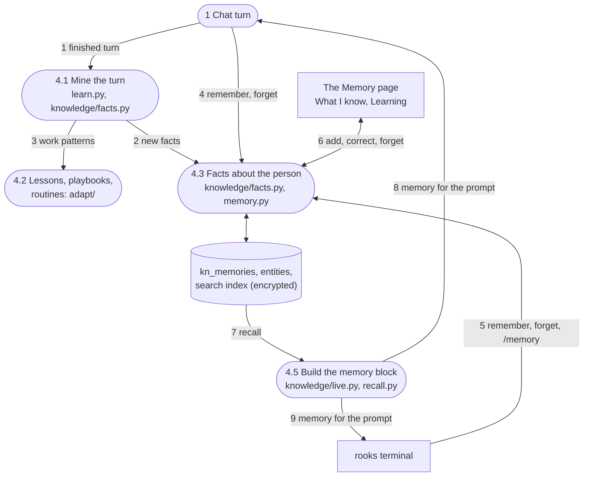
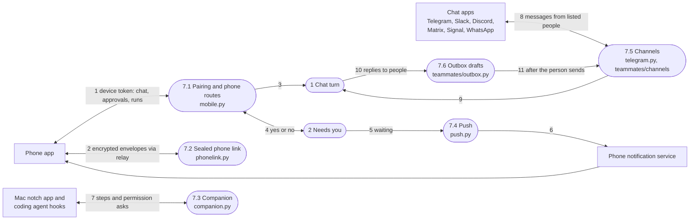

# Rooks: how it is built

An architecture map of the Rooks repository for the owner. It covers what the parts are, how information moves between them, where data and secrets are kept, what could be cleaned up, and what a workplace team would miss today.

**Source.** A read-only survey of branch `main` at commit `81125e1` on 8 November 2026. This copy describes branch `cleanup/workplace` (stacked on `phase-1a/terminal-safety`), which carries out the cleanup in section g: the component map (section e) marks what it removed, hid or changed, the cleanup tables (section g) have a Done column, and section i says which contradictions it fixed. The data flows (sections b to d), stores (section f) and gaps (section h) are as surveyed on `main`, apart from notes where a part has since moved.

**A caveat on dates.** The whole repository was imported in one commit on 6 November 2026. A "last changed" date therefore only separates files touched since 7 or 8 November from the rest. It says nothing about how old or how alive a file really is. Status in this document comes from what imports what, what the screens call, and what the tests cover.

**Words used here.**

- *The app*: the Rooks program on the person's computer. It is a web page shown in a desktop window (or in a browser) with a Python server behind it. In the code it is still often called "Workbench" or "AI Workspace".
- *The assistant*: the AI inside the app. One assistant serves every channel: the app, the terminal, the phone, chat apps and schedules.
- *Run log*: one table (`actions`) where every model call, tool call, approval and outbound connection is written down.
- *Needs you*: the one inbox of everything that is waiting for the person to say yes or no.
- *The Room*: the assistant's own computer on this machine (a small Linux guest, a private desktop, or a private folder and shell). The app always says which one it really is.
- *Bridge*: a door that lets the terminal and helper programs use the app's models, memory and approvals.
- *MCP*: a common standard for plugging extra tools into AI assistants. Rooks can both offer tools this way and use other people's tools this way.
- *DFD*: a data flow diagram. Rounded boxes are processes (things that do work), cylinders are stores (where data rests), plain boxes are people or outside services. Arrows are numbered so the tables can describe them.

---

## a. What Rooks is

Rooks is a personal AI assistant that a person runs on their own computer, not in someone else's cloud. It is an app window with chat, mail, calendar, tasks, files, memory and scheduled routines, plus three command line helpers: `rooks` (a coding agent in the terminal), `rooks-browser` (an agent that uses a web browser) and `rooks-desk` (an agent that uses the computer's own apps). It can use almost any AI model: a paid key, a free provider, a model running on the computer, or the person's existing ChatGPT, Claude or Copilot plan. Anything risky (sending mail, running a command, letting a file leave the Room) is held until the person says yes, and every step is written to a run log they can read. A phone app pairs with the computer to answer approvals and chat on the move. Today it is built for one person on one computer; it is not yet a shared workplace service.

---

## b. Context diagram

Rooks and the outside world. The dashed arrow is a connection that does not exist yet.

What sits outside and how it is reached:

| Outside party | How Rooks reaches it | Notes |
|---|---|---|
| The person | The desktop app window, or a browser on the same computer, or a second browser paired with a code | One person per install |
| Phone | The phone app, paired once; over Wi-Fi, or through an encrypted relay mailbox | Not in any app store yet |
| AI model providers | Direct web calls with the person's key, a model on the computer, or the person's own Claude Code, Codex or Copilot program | Every call is in the run log |
| Mail and calendar | Google and Microsoft through their own sign-in; any other provider through standard mail protocols and app passwords; Apple Mail on a Mac | Calendars also from shared calendar links |
| Chat apps | Telegram, Slack, Discord, Matrix, Signal, WhatsApp and email as chat | Only listed people get answers |
| Websites | The browser helper, signed in once in its own browser profile | Used by the Sites feature |
| Web search | Brave, Tavily or a self-hosted search server | Key stored encrypted |
| Teams, ServiceNow, Monday, SharePoint | Not connected | Jira, Asana and Trello: read-only import into the Team board |

---

## c. Level 1 data flow diagram

The six main jobs the app does, the three stores they share, and the main flows. Phone and chat apps are drawn in section d.5.

| Flow | What moves | How |
|---|---|---|
| F1 | The person's message and any attachments | From the chat page; the reply streams back word by word |
| F2 | The prompt, the list of tools, earlier messages | A web call to the chosen provider, or a run of the person's own Claude Code, Codex or Copilot program |
| F3 | The answer, or a request to use a tool | Streamed back; the model choice ("Auto") picks fast or strong models and falls back when one is out of quota |
| F4 | A tool call that changes something outside (send, run, delete, pay) | Written to the run log as "waiting" |
| F5 | "May I do this?" and the person's yes or no | Shown in Needs you in the app, the phone, the terminal or by voice; the first answer wins |
| F6 | Each model call, tool call, approval and outbound connection | One row per step in the run log (`actions` table) |
| F7 | A scheduled prompt, an automation, a background job | Background loops in the app start a normal assistant turn |
| F8 | The finished conversation turn | After each turn, facts and reusable skills are mined |
| F9 | Facts, people, projects, links between them | Three separate memory stores today (see d.4) |
| F10 | A short block of what the assistant knows, sized to fit | Added to the next prompt |
| F11 | Start, run a command, click, type, take a picture, save a point | The `use_room` tool |
| F12 | Messages, drafts, sends, calendar events | Google and Microsoft through their own sign-in; others through standard mail and calendar protocols |
| F13 | Calendar events, mail account details, drafts | Calendar synced every 15 minutes |
| F14 | "A new mail arrived", "a meeting is near" | Triggers for automations |
| F15 | Sign-in tokens for mail and calendar | Decrypted only when needed |
| F16 | Provider keys | Decrypted only when needed; never written to logs |

---

## d. Level 2 data flow diagrams

### d.1 A chat turn with an approval

The person asks the assistant to send an email. The model wants to use the "send mail" tool, which is held until the person agrees, then checked afterwards.

Notes:

- The same loop serves every channel: the app, the terminal (`rooks talk`), the phone, Telegram, schedules and coworkers.
- If the prompt is too long, the loop compacts older messages and tries again (`compression.py`); the reply shows a "compacted" note.
- If the app restarts in the middle of a turn, the cut-off turn gets a note and the next turn says it resumed (`restart.py`).
- Receipts check that a change really exists (for example that the sent mail is in the sent folder). Claim checks compare the final answer with the receipts so the assistant cannot claim work it did not do.
- The approval can be answered in the app's Needs you sheet, on the paired phone, by voice, or from the terminal. It is answered exactly once.

### d.2 A scheduled routine

A morning routine ("plan my day") runs at 8:00, or an automation fires when a matching mail arrives.

Notes:

- Schedules run one at a time, in the workspace's time zone.
- The same idea is created in four places today: Automations (schedules and triggers), Teach (a playbook each morning), Coworkers (scheduled jobs for AI coworkers) and the Company page (agents working a task queue). They write to different tables.
- Budget checks in `usage.py` pause an agent before it overspends.

### d.3 The Room: terminal, files and browser

The Room is the assistant's own computer. The person watches it, steps in, and decides whether any file may leave it.

Notes:

- The Room only shows a screen when a real display exists. Its status always names the screen, the pointer, how isolated it is, and a plain label.
- The Room has its own browser (`room_browser.py`, engine in `rooks-try/rooks_try/browser.py`): a real Chrome, Edge or Chromium run headless with the Room's own profile and driven only over a pipe, never a port. On Windows the Room starts it itself with the pipe in place and keeps every one of its processes in a job (`rooks_try/winproc.py`); when the organisation has switched remote debugging off for that browser, the Room says so and sends the person to their IT team. The separate helper program (`rooks-browser`, reached through `browser_proxy.py`) still drives the person's own signed-in browser for the Browser page and Sites.
- On Windows every program the Room starts (each terminal, each quick command and the browser) runs in a job of its own nested in one Room job that the app's backend holds (`winproc.room_job()`, kill on close): stopping the Room ends them all, and so does the backend ending however it ends. The desktop shell in turn holds its backend in a kill-on-close job (`desktop/src-tauri/src/sidecars.rs`), so ending Rooks ends everything. A job keeps them together; it is not a wall, and status says `isolation: "none"`, `containment: "job"`.
- The app also has its own Terminal page (`terminal_pty.py`), a shell on the person's own computer, separate from the Room's terminals.

### d.4 Memory and learning

What the assistant learns after each turn, and where it keeps it. Since the cleanup branch (g.2a) there is one store for
facts about the person, `kn_memories`, which chat, the Memory page and the terminal all read and write.

Notes:

- One store: a fact told in chat is on the Memory page and in the terminal's /memory at once, and "forget" anywhere
  removes it everywhere and from the next prompt. A newer fact about the same thing (same predicate, such as lives_in or
  works_at) replaces the older one, which is kept as history ("Why do you know this?" shows it); a guess that disagrees
  with what the person said themselves waits on the Memory page ("Needs your call") and their word stays in use.
- The older `memories` and `adapt_facts` tables were moved into `kn_memories` once by `db.migrate_v5` and dropped.
- Sensitive text is encrypted with a data key that is itself protected by the app's secret (or the computer's keychain
  on the desktop build). The search index uses scrambled words so it can be searched without storing plain text. A key
  or password is never kept in memory, because memories go into prompts.
- Skills are separate: skills from GitHub pass a security gate (`skills_hub.py`, `skill_scan.py`) and run in a sandbox (`skill_sandbox.py`).
- A daily backup copies the whole database, still encrypted (`knowledge/backup.py`).
- A teammate's own notes (`tm_notes`, teammates/memory.py) are still a separate store (BACKLOG.md).

### d.5 Phone and chat channels

How the phone, the Mac notch app and chat apps reach the same assistant.

Notes:

- Three separate ways for a phone or another app to reach this computer exist: device tokens (`mobile.py`), sealed envelopes (`phonelink.py`) and companion tokens (`companion.py`).
- Slack and Discord keep a live connection open; Matrix polls; Signal needs a separate signal service the person runs; WhatsApp needs a public address for its webhook, which a home computer usually does not have.
- Messages to other people are drafts first; only the person sends them. Team-lead messages to staff go through a separate outbox (`team/outbox.py`) with the same rule.
- There is no Microsoft Teams channel.

---

## e. Component map

Status words: **live** (used and reachable), **half built** (exists but a part is missing or unused), **duplicate** (another module does the same job), **dead** (nothing uses it). Line counts are approximate.

The map describes branch `cleanup/workplace`: a row for something this branch removed says **removed** and names the
step in section g; a row it changed says so in its status. Everything else is as surveyed on `main` at `81125e1`.

### e.1 The app's server (`workbench/backend/app`, about 32,600 lines on `main`; 938 backend tests on this branch)

**Wiring and health**

| Module | What it does | Status |
|---|---|---|
| main.py | Builds the server, runs upgrades, starts 14 background loops, mounts every route and the web page | live |
| config.py | Settings and defaults: data folder, app secret, add-on addresses, desktop flags (the unread Claude Code and Codex launcher addresses are gone, contradiction 11) | live |
| db.py | The database file, the core tables, settings helpers (schema version 5: the memory move, g.2a) | live |
| health.py | Health checks on request, and the list of background loops | live |
| restart.py | Tells the truth about restarts: cut-off turns get a note, the next turn says resumed | live |

**Chat and models**

| Module | What it does | Status |
|---|---|---|
| assistant.py | The one agent loop for every channel: prompt with memory, 60 tools, approvals, receipts, compaction | live |
| assistant_api.py | Routes for chat, conversations, approvals, runs, memories, skills, schedules, inbox, usage, Company | live |
| api.py | One large file of routes: sign-in and lock, desktop session, providers and keys, notes, tasks, calendars, mail, research | live (should be split) |
| llm.py | Model calls for the rest of the app, each logged and priced | live |
| adapters.py | One class per provider type, plus running the person's own Claude Code, Codex or Copilot | live |
| router.py | "Auto" model choice: fast or strong model, quotas, cool-downs, fallback | live |
| catalog.py | Model facts (context size, price, vision) from a bundled list, refreshed daily | live |
| (scripts/build_model_catalog.py) | A build tool that makes the bundled model list; moved out of the app (g.4a) | live (tool) |
| compression.py | Summaries of long chats that no longer fit | live |
| tool_results.py | Keeps long tool results so the model can read the rest later | live |
| attachments.py | Chat images and documents from the app, Telegram and the terminal | live |
| usage.py | Token and cost counts; budget checks that pause agents | live |
| siwc.py | Use a ChatGPT plan without an API key | live |
| plan_signin.py | Install and sign in to Claude Code, Codex or Copilot from the app | live |
| local_agents.py | Starts the browser helper when needed | live |
| finetune.py | Training sets from chats and hosted fine-tuning jobs | live (Advanced) |
| openapi.py | Signed-in listing of the routes | live |

**Approvals, Needs you and the run log**

| Module | What it does | Status |
|---|---|---|
| actions.py | The run log: every action, model call, approval and outbound connection | live |
| needs_you.py | One inbox of everything waiting on the person, answered once | live |
| presence.py | What the assistant is doing now, and the one poll the screen uses | live |
| receipts.py | Proves a change exists; checks claims against proof | live |
| goals.py | Goal mode: keeps taking turns until an objective is met | live |
| push.py | Phone notifications for approvals and finished runs | live |
| companion.py | Live view of every agent with approvals from the notch app or phone; its description now says so (contradiction 15) | half built (no web page uses it) |
| companion/hooks/ | Hook script and installer for Claude Code, Codex, Gemini and Cursor | live (developer only) |

**Memory and learning**

| Module | What it does | Status |
|---|---|---|
| learn.py | After each turn: facts into the one memory store (knowledge/facts.py) and reusable skills | live |
| learn_hook.py | Tells the learning layer about Files and Sites work | live |
| adapt/playbooks.py | "Show me how": a recording becomes a playbook with a schedule | live |
| adapt/recorder.py | Recording interface; only the browser recorder is wired | half built |
| adapt/jobs.py | Notices habits and proposes routines | live |
| adapt/feedback.py | Thumbs, comments and edits become lessons | live |
| adapt/hooks.py, routes.py, store.py | The entry points, routes and eight tables of the learning layer | live |
| knowledge/memory.py | The one memory store: tiers, sources, duplicates, a newer fact replacing an older one, conflicts, pinning, forgetting | live |
| knowledge/facts.py | Facts about the person for chat, the terminal and the Memory page; the learner; the one-time move of the older stores | live |
| knowledge/graph.py | People, projects, files, sites and how they relate | live |
| knowledge/index.py | One search index over everything, on scrambled words | live |
| knowledge/recall.py | Mixed recall: search, graph, recency, pinning, within a size budget | live |
| knowledge/live.py | Keeps the graph current and builds the memory block for the prompt | live |
| knowledge/adapters.py | Indexes projects, tasks, files, sites and notes into the graph and index | live |
| knowledge/crypto.py | The data key for every encrypted column | live |
| knowledge/importers.py | Imports ChatGPT, Claude and Grok exports, Notion and Obsidian | live |
| knowledge/improve.py | Nightly improvement proposals, only when switched on | live |
| knowledge/backup.py | Daily database backups, restore, full export | live |
| knowledge/routes.py, mobile.py, text.py, schema.py | Routes, phone search, word handling, versioned upgrades | live |
| skills_hub.py | Skills from GitHub behind a security gate, trial run, audit | live |
| skill_scan.py | Offline security checks for skills | live |
| skill_sandbox.py | Runs skill scripts in isolation | live |
| skill_store.py | Suggested skills and connectors | live |

**Schedules, automations, coworkers and team**

| Module | What it does | Status |
|---|---|---|
| scheduler.py | Timed prompts, delivered to the inbox and optionally Telegram | live |
| front_door.py | The one main conversation; decides where results land | live |
| automations.py | "When X happens, do Y, ask me first" | live |
| jobs.py | Background jobs board with notices and questions | live |
| auto_tools.py | Assistant tools for automations, jobs and live documents | live |
| livedocs.py | Editable sheets, charts and documents inside replies | live |
| automations_api.py | Routes for automations, jobs and live documents (was v02_api.py) | live |
| company.py | AI agents in an org chart with budgets working a task queue | duplicate |
| starters.py | A proposed set of coworkers and schedules for a line of work | live |
| team/ (store, routes, engine, lead, replies, outbox, parse, sms, memory, loop, tools) | A team lead's board for human staff: tasks, plan, nudges by mail, Telegram or text, sub-agents | live |
| team/connect.py | Member updates and cloud task sync; the cloud is not set up | half built |
| team/trackers.py | Read-only import from Jira, Asana and Trello; no write-back | half built |
| teammates/ (store, routes, groups, computer, memory, hooks) | Several named AI assistants with personas, group chats, own folders | duplicate (fourth "coworker" idea) |
| teammates/vault.py | Logins, cards and addresses the assistant uses without seeing them | live |
| teammates/pages.py | Save a result as a page to edit and share | live |
| teammates/outbox.py | Every outgoing message is a draft until the person sends it | live |

**Mail, calendar and sign-in**

| Module | What it does | Status |
|---|---|---|
| mail.py | Read and send mail on any standard server; routes Google, Microsoft and Mac accounts | live |
| cloud_mail.py | Gmail and Microsoft mail and calendar for accounts connected with one sign-in | live (no tests) |
| connect.py | "Connect Google" and "Connect Microsoft" sign-in; tokens stored encrypted; the work sign-in asks only who you are, then one switch's permissions at a time | live |
| work_scopes.py | The work account's switches and the permissions each asks for (design 0012) | live |
| work_suite.py | The work account, its switches, the gate every work tool passes, Needs you titles, the IT note | live (Microsoft) |
| work_graph.py | OneDrive, SharePoint, Teams, meeting transcripts, Planner and To Do through Microsoft Graph | live, tested against a fake only |
| work_suite_tools.py, work_suite_api.py | The assistant's `work_*` tools and `/api/work` (the Work apps page and the terminal's `/work`) | live |
| oauth_clients.py | The public app identifiers used for that sign-in | live |
| mail_autodetect.py | Finds mail and calendar settings from an address | live |
| mac_mail.py | Mail through accounts already in Apple Mail | live (Mac only) |
| calendar_sync.py | Calendar links, CalDAV, Google and Microsoft calendars every 15 minutes | live |
| services.py | Shared operations for notes, tasks, events and agenda | live |

**The Room, computer and browser**

| Module | What it does | Status |
|---|---|---|
| room.py | The Room: status, start, stop, save points, reset, run, click, type, picture, hand-off | live |
| room_terminal.py | Real shells inside the Room, kept on the server, with private logs (on Windows PowerShell or Git Bash on ConPTY, through rooks_try/winproc.py) | live |
| room_files.py | Read-only listing of the Room folder | live |
| room_browser.py | The Room's own browser: one engine over a pipe, its tabs, the live picture and input (on Windows in a job, with IT policy respected) | live |
| terminal_pty.py | The app's own Terminal page on the person's computer (PowerShell on ConPTY on Windows) | live (page hidden behind Advanced, g.3a) |
| browser_proxy.py | Passes Browser page requests to the separate browser helper | live |
| desk_proxy.py | Passes Computer page requests to the computer-use helper | live |
| handoff.py | Notes the browser leaves for the Computer page | live |
| surfaces.py | Pairing codes so a second browser can reach this computer | live |

**Terminal link and tool servers**

| Module | What it does | Status |
|---|---|---|
| bridge.py | The model door for the terminal and helpers, plus Rooks Desk's send-mail | live |
| rooks_link.py | The terminal's link: memory, skills, search, approvals, packs, whole turns, hand-off codes | live |
| cli_agents.py, cli_agents_api.py | Coding jobs handed to rooks, Claude Code or Codex in a folder | live (developer only) |
| tools.py | A tool server for other chat programs (notes, tasks, calendar, mail search, drafts) | live (Advanced) |
| mcp_server.py | The same tools offered the MCP way | live (Advanced) |
| mcp_client.py, mcp_client_api.py | Rooks using the person's own MCP tool servers | live |

**Phone, voice and channels**

| Module | What it does | Status |
|---|---|---|
| mobile.py | Phone pairing, device tokens, home, approvals, chat | live |
| teammates/phonelink.py | End-to-end encrypted phone link through a relay | live (overlaps mobile.py) |
| telegram.py | Telegram chat with the same assistant | live |
| teammates/channels.py | Slack, Discord and Telegram settings and connections | live |
| teammates/more_channels.py | Matrix, Signal, WhatsApp and email as chat | half built (needs extra services) |
| anywhere.py | A global shortcut that asks about selected text in any app | live |
| voice.py | Dictation, spoken approvals and speech | live |
| meetings.py | Record or import a meeting; notes, decisions, tasks, follow-up draft | live |
| projects_mobile.py | Phone views of projects, history undo and checked answers (was v02_mobile.py) | live |
| appearance.py | The chosen look, shared with phone and terminal | live |

**Files, work sites, projects and research**

| Module | What it does | Status |
|---|---|---|
| files.py | Reads any file into one shape with citations | live |
| analysis.py | The Files library: statistics, comparisons, new Excel, Word and PDF | live |
| compute.py | Runs data analysis code in a sandbox | live |
| helpers.py | Installs optional helper programs for Files | live |
| work_api.py, work_tools.py | Routes and assistant tools for Files and Sites | live |
| sites.py | Websites the person works in: signed in once, records, watches, actions with approval | live |
| projects.py | Projects that hold files, sites, chats, notes and people | live |
| history.py | One timeline of everything done, with undo and export | live |
| checked.py | Checked answers: lists sources and verifies claims | live |
| projects_hooks.py | Installs projects, history and checked answers (was v02_hooks.py) | live |
| research.py | Deep research: search, read pages, write a cited report | live |
| search.py | Web search through Brave, Tavily or a search server | live |
| media.py | Image generation saved to Files | live |
| packs/ (registry, routes, trade, trade_push, legal, study, store, tools, mobile_routes, ai) | Optional Trade, Legal and Study bundles; Trade pushes to ServiceM8 and Xero | live (pages hidden behind Advanced, g.3a) |

**Security and secrets**

| Module | What it does | Status |
|---|---|---|
| security.py | Sign-in cookie, passwords, encryption, signed tokens, route guards | live |
| redact.py | Removes keys from every log line and error | live |
| egress.py | Records every outbound connection; shown on the Privacy page | live |
| keychain.py | Provider keys in the computer's keychain on the desktop build | live |
| account.py | Sign-in to a Rooks cloud service and paid plan checks; the cloud does not exist in this build; plan checks are off unless a build sets `AIW_PLAN_CHECKS=1` (g.3a) | half built |
| plan_tiers.py | Which plan each feature belongs to (was features_v02.py) | live |

### e.2 The screens (`workbench/frontend/src`)

67 route patterns, of which 4 are on the top bar (Chat, Room, Jobs, Settings), 12 in its menus (Day, Memory, Library), 31 only in the More sheet, and 6 with no place in the navigation. Every one of the 455 server paths the screens call exists on the server.

| Part | What it does | Status |
|---|---|---|
| pages/registry.ts | The one list of pages and where each appears | live |
| App.tsx, api.ts | Starts the app, sign-in, mounts routes; the client that talks to the server | live |
| shell/ | Top bar, presence line, side Stage, phone dock, More sheet, the one status poll | live |
| pages/Assistant.tsx, chat/ | The chat page: thread, composer, result cards with undo, model and mode chips | live |
| chat/tabs/SkillsTab.tsx | An older skills editor; its list now lives on the Skills page | removed (g.1a) |
| room/ | The Room page: terminal, screen, files and save-point windows; compact Room on the Stage | live |
| needs/ | The Needs you sheet | live |
| stage/surfaces.tsx | How the side Stage draws the Room, a browser job or a computer job | live |
| memory/ | The Memory page: what I know (add, correct, forget), people, projects, conflicts, tidy up, learning switches, backups and imports | live |
| memory/Improved.tsx | A "What I improved" card that nothing showed | removed (g.1a) |
| teammates/ | Teammates, Channels, Groups, Pages and Vault pages | live |
| team/ | The human team lead's board, plan, tracker settings, outbox | live |
| v02/ | Jobs board, job notifications, live sheets and charts, trigger builder | live |
| Day pages | Mail, Calendar, Tasks, Home | live |
| Memory pages | Skills, Teach (About you and the chat's Memory tab are the Memory page now) | live |
| Library pages | Files, Notes, Documents, Sites, Projects | live |
| Workspace pages | Automations, Research, Meetings, Talk, Coworkers, Browser and Computer (only when the helpers run); Packs moved behind Advanced (g.3a) | live |
| pages/Code.tsx | Coding jobs plus copies of the Terminal, Browser and Computer pages as tabs | duplicate (hidden behind Advanced, g.3a) |
| pages/TerminalPage.tsx, terminalHost.tsx | A real shell in the app window | live (hidden behind Advanced, g.3a) |
| pages/Customize.tsx | A page of tiles that only linked to other pages; `/customize` opens Settings | removed (g.1a) |
| pages/Company.tsx | AI agents in an org chart (Advanced) | live |
| Settings pages | Settings, Connect, Models, Voice, Appearance, Plan, About, Privacy, Phone | live |
| Advanced pages | History and Company always; Run log, Insights, Status, Compare, Fine-tune, Extra tools, Code, Terminal and Packs only with Show developer tools on (g.3a) | live |
| Welcome, Auth, AskBar | First run, sign-in, the floating ask bar | live |
| Beside.tsx | An older side-by-side picker that the Stage now builds on | half built |
| Palette.tsx | The command menu (Ctrl or Cmd + K) | live |
| ui/, lib/, motion/, voice/, packs/, learn/ and helpers | Shared building blocks | live |

### e.3 The terminal, helpers and outer shells

| Part | What it does | Status |
|---|---|---|
| rooks-code (`rooks`) | Terminal coding agent: loop, file and command tools, full-screen terminal, Room and Needs you commands, shared memory and approvals, `rooks talk` | live |
| rooks-code redact.py, theme.py | Copies of the app's rules, kept in step by tests (theme has no test) | duplicate (on purpose) |
| rooks-browser | Browser agent using the person's Chrome or Edge; serves the Browser page, Sites and recordings | live |
| rooks-browser/app | An Electron browser preview with an "Ask Rooks" panel; nothing ships or starts it | half built |
| rooks-desk | Computer use on the person's own apps, with approvals, a kill switch and an on-screen frame | live |
| rooks-desk llm.py, mcp_client.py | Copies of other modules that have drifted apart | duplicate |
| rooks-try | The Room driver: Linux guest, private desktop, or private folder and shell | live |
| desktop/src-tauri, desktop/sidecar | The installable desktop app (version 1.0.6): starts the server, signs the window in, tray, shortcut | live |
| desktop/src-tauri sidecars.rs (three rows) | Placeholder rows for helpers "coming later" | removed (g.1a) |
| desktop/launcher | The `ai-workspace` command and the installer behind the install scripts | live |
| desktop/rooks-native | A desktop window drawn without a web view (version 0.4.0); since design record 0003 (W1) only the floating Ask palette | half built |
| mobile/ | The phone app (Expo); not in any app store | live |
| companion/macos | The Mac notch app; built by hand, no automatic checks | half built |
| vscode-extension | Ask the assistant from VS Code; finds the open app from `app.json` (contradiction 20); not on the Marketplace | half built |

### e.4 Older and supporting material at the top level

| Part | What it does | Status |
|---|---|---|
| assistant/ and the `hermes` link | A kit to run a different, third-party assistant (Hermes) on a server | live (separate product) |
| browser-agent/ | The old Docker browser agent; the Docker `browser` add-on is Rooks Browser now | removed (g.1a) |
| cli/ws | A second, older terminal chat client, shipped with each release | live (duplicates `rooks talk`) |
| cli-launcher/ | A Docker service to run Claude Code or Codex; nothing in the app calls it, and the app is no longer given its address or key (contradiction 11) | half built (owner to decide) |
| paperclip/, searxng/ | Settings for optional server add-ons | live |
| marketing/launch-posts.md | Draft launch posts with claims that were no longer true | removed (g.1a) |
| screenshots/ | 347 old screenshots, 40 MB | removed (g.1a) |
| scripts/test-all.sh | Runs every suite that runs on one computer, now including `cli/ws`, the CLI launcher, the VS Code add-on and the phone app; AGENTS.md lists what only the online checks run (contradiction 12) | live |
| scripts/ci, security-scan.sh, hooks | Online check helpers, secret and dependency scans | live |
| scripts/hermes-config.sh, paperclip-invite.sh, sync-opencode-config.sh | First-run helpers for the server add-ons | live |
| scripts/write-oauth-clients.py, setup-sign-in.sh | Register the Google and Microsoft sign-in apps for releases | live |
| scripts/release/package.sh | Builds a source zip; nothing calls it | unknown |
| scripts/check-theme-contrast.py | Colour contrast check that nothing runs | half built |
| scripts/audit/ | Regenerates old evidence pages; now `docs/history/scripts/audit/` | moved (g.1a) |
| scripts/test_vertical_slice.py | A test tied to one developer's folder path | removed (g.1a) |
| install.sh, install.ps1 | One-command install for one person, no Docker | live |
| install-server.sh, setup.sh, docker-compose files, .env.example | The Docker server install with add-ons; default name Rooks (g.4a) | live (secondary) |
| .github/workflows | Checks, desktop builds, releases, server image, Mac window check, native window build | live |
| README.md, QUICKSTART.md, SECURITY.md, THIRD_PARTY_NOTICES.md, docs/ | Guides, design records, decisions, security model; the stale parts in section i are corrected (g.4a, documents) | live |
| PROGRESS-desktop.md, ai-workspace-audit-report.md, docs/AUDIT.md and other dated reports | Snapshots from earlier branches: the two root reports removed, docs/AUDIT.md and the rest moved to `docs/history/` with a README | removed or moved (g.1a) |

---

## f. Stores and where secrets live

### f.1 Where data rests

| Store | Where | What it holds | Secrets |
|---|---|---|---|
| The workspace database | One file, `workbench.db`, in the app's data folder | Chats, the run log, provider connections, settings, notes, tasks, events, mail accounts, skills, schedules, inbox, devices; plus many more feature tables that modules create on first use | Yes, encrypted |
| Memory and knowledge tables | Same file | Graph, memories, search index; sensitive columns encrypted with a data key | Yes, encrypted |
| App secret and tool key | Two files in the data folder, readable only by the owner, unless set in the environment | The root key that encrypts every stored key and signs sessions; the key for the tool servers | Yes |
| Computer keychain | macOS Keychain, Windows Credential Manager or the Linux secret service (desktop build) | Provider keys, site keys, vault items, the memory data key, as references; moved into the database on first start | Yes |
| Files library | `files/` in the data folder | Uploaded and generated documents | No (but may be sensitive) |
| Attachments and phone uploads | `attachments/`, `mobile_uploads/` | Chat images and documents | No |
| Installed skills | `skills/` | Skill folders pinned to a version | No |
| Teammate folders | `teammates/<id>/` | Each teammate's files and its own browser profile | Yes (browser cookies) |
| Backups | `backups/` | Daily database copies (still encrypted) and export zips | Yes |
| Fine-tune, speech models, coding runs | `finetune/`, `whisper/`, `cli-runs/` | Training files, local speech models, coding logs | No |
| Browser helper profiles | rooks-browser's own folder | Signed-in browser sessions for work sites, screenshots, downloads | Yes |
| Computer helper folder | rooks-desk's own folder | A screenshot per step, shell output, deleted-file trash | Yes |
| The Room folder | `~/.ai-workspace/try-room` | Files made in the Room, up to 20 save points, private terminal logs | No |
| Project folder `.rooks/` | Inside each project the terminal works in | Run receipts, undo copies, background job logs | No |
| Old server add-on volumes | Docker volumes (server install only) | Browser jobs, Hermes, Paperclip, Open WebUI data | Yes |

### f.2 Where secrets live, and the weak spots

| Secret | Kept in | Protection |
|---|---|---|
| App secret (the root key) | A file readable only by the owner, or the keychain on the desktop build | Everything else hangs off this |
| Provider keys, mail sign-in tokens, channel bot tokens, tracker tokens, search keys | The database, encrypted with the app secret; or keychain references | Never written to logs (`redact.py`) |
| Memory data key | Keychain, or wrapped by the app secret | Protects every encrypted memory column |
| Vault logins and cards | Database, encrypted, or keychain | The assistant fills forms without seeing them; filling needs a yes |
| Bridge key for the terminal (`app.json`) | A file in the person's settings folder, owner-only, removed when the app quits | Any program running as the person can read it, so it can never answer an approval |
| Terminal access token | Only its fingerprint is stored in the database | Needed for Room and Needs you commands from the terminal |
| Terminal provider keys (`rooks-keys.json`) | Owner-only file in the settings folder | Plain on disk |
| Companion token (`companion.json`) | Owner-only file in the home folder | Plain on disk |
| Phone device token and keys | The phone's secure storage | Device-only |
| Paired browser token | The browser's local storage | **Weak spot:** any script on the page could read it |
| Typed terminal history (`rooks-history`) | Settings folder | **Weak spot:** every prompt typed, not cleaned of secrets |
| Docker server `.env` | The server checkout, owner-only | All server secrets in one file |
| Release signing and sign-in app values | GitHub repository secrets | Used only by release builds |

---

## g. Cleanup proposal

The owner approved this proposal. "Hide behind Advanced" means keep the code and the tests but take the page out of the normal menus. The Done column in each table, and the sections ending in "a", record what branch `cleanup/workplace` has done.

### g.1 Delete

| Path | Why | Risk | Done |
|---|---|---|---|
| screenshots/ | 347 old branch screenshots (40 MB). No document shows them; `.gitignore` already says this folder should not be tracked. Every install downloads them. | Low. Fix one pointer in `docs/motion.md`. | Done (g.1a) |
| marketing/launch-posts.md | Claims that are false today ("mail never sends", "no shell tool", "350 MB"). Publishing it would break the "never fake results" rule. | Low. Rewrite launch copy from the current README if needed. | Done (g.1a) |
| PROGRESS-desktop.md | Log for an old branch; says the licence is MIT, but it is now proprietary. | Low. | Done (g.1a) |
| ai-workspace-audit-report.md | A 4 November snapshot that cites a script that does not exist. | Low. Move to a history folder if the record matters. | Done (g.1a) |
| scripts/test_vertical_slice.py | Hard-wired to one developer's folder, so it cannot run anywhere else. | None. | Done (g.1a) |
| frontend chat/tabs/SkillsTab.tsx | No route can open it; the Skills page replaced it. | Low. Update one text check in the tests. | Done (g.1a) |
| frontend memory/Improved.tsx | Nothing shows it. | Low. Decide whether Home should show the card instead. | Done (g.1a) |
| frontend pages/Customize.tsx | Every tile links to another page; Settings and the More sheet already do this. | Low. Point the old `/connect` link at Settings. | Done (g.1a) |
| desktop sidecars.rs placeholder rows | Three "coming soon" rows; one points at the old browser agent. | Low. | Done (g.1a) |
| api.py `/api/trade` routes | No screen calls them. | Low. | Done (g.1a) |
| browser-agent/ | The old Docker browser agent; rooks-browser replaced it and speaks the same job language. Two browser agents with different safety rules. | Medium. The Docker "browser" add-on, setup script, Paperclip and Hermes settings, README, one check job and one terminal test refer to it. Replace the Docker service with rooks-browser first. | Done (g.1a) |
| cli-launcher/ (and its two Docker add-ons and settings) | Nothing in the app reads its address; running the person's own Claude Code or Codex already works another way. | Medium. It is the only plan-based path for a Docker server with no local programs. Ask the owner first. | Not done: the owner decides. The app no longer gets its address or key (contradiction 11) |
| frontend pages/Code.tsx | Coding is for developers; the page also repeats the Terminal, Browser and Computer pages. | Medium. The terminal keeps coding jobs; update the chat's plan and build modes and two tests. | Hidden instead (g.3a); deleting it is the owner's call |

**Totals for the "Delete" table** (files only; partial deletions inside other files are not counted):

| Group | Files | Text lines | Size |
|---|---|---|---|
| Safe now (screenshots, marketing, two root reports, one script, three screens) | 354 | 638 (plus 1,036 lines of notes and scripts inside screenshots/) | 40.5 MB |
| Needs a step first (browser-agent, cli-launcher, Code page) | 34 | 2,468 | 0.1 MB |
| **All** | **388** | **3,106 (4,142 with the screenshot notes)** | **about 40.6 MB** |

Counted from `main` with git. 40.5 MB is 40,516,226 bytes; screenshots/ alone is 40,476,156 bytes (328 pictures, 5 videos, 3 animations and a few notes).

### g.1a Done on branch `cleanup/workplace`

Status of the "Delete" table and the history move from g.2, measured with git against `f837498` (this document's own
commit on the branch).

| Item | Outcome |
|---|---|
| screenshots/, marketing/launch-posts.md, PROGRESS-desktop.md, ai-workspace-audit-report.md, scripts/test_vertical_slice.py | Deleted. `docs/motion.md` no longer points at the recordings (it also named an animation gallery page that does not exist; fixed). A test fails if screenshots/ is tracked again. |
| pages/Customize.tsx | Deleted. `/customize` and the old `/connect` link redirect to Settings; the two Settings rows that linked to it are gone; Settings replaces it in the Beside list. |
| chat/tabs/SkillsTab.tsx | Deleted, with a correction to the table above: the chat tab itself had no route, but the Skills page showed the same component ("Learned or written here"). That list now lives in `pages/Skills.tsx` as `LearnedSkills`, on the shared parts with loading, empty and error states. |
| memory/Improved.tsx | Deleted. The improvements routes stay; whether Home shows the card is in BACKLOG.md. |
| sidecars.rs placeholder rows | Deleted, with a unit test that every listed helper is enabled and in `bundle.externalBin`. |
| `/api/trade` routes | Deleted with `projects.set_trade`. A saved trade is still read by Home and the status answer. |
| browser-agent/ | Deleted after the Docker `browser` add-on became Rooks Browser (`rooks-browser/Dockerfile`, service mode). Paperclip, Hermes and Open WebUI no longer get `BROWSER_API_KEY` or a browser tool: that key answers approvals, and those add-ons run agents on their own. The CI job now builds and checks the add-on image. |
| Old audits and evidence | Moved to `docs/history/` with a README; links fixed. |
| cli-launcher/, pages/Code.tsx | Left alone: the owner has not decided them. Hiding Code is the next step. |

Totals removed: 375 files (347 under screenshots/, 21 under browser-agent/, 4 root files and scripts, 3 screens),
3,226 text lines in those files (336 of them are pictures, videos or other binary files with no lines), and
40,578,218 bytes. Contradictions 5, 9, 10, 16 and 21 in section i no longer apply; 12 and 13 are smaller (one
browser agent now).

### g.2 Merge

| Path | Into | Why | Risk | Done |
|---|---|---|---|---|
| learn.py (memories) + adapt/knowledge.py (adapt_facts) + knowledge/memory.py (kn_memories) | One memory store in knowledge/ | Three stores for one idea; one Memory page, one "forget" | Medium. Existing users need a one-time move; two tests check the old path. | Done (g.2a) |
| Memory page + About you + chat Memory tab | The Memory page | Three screens over three stores | Medium. Only after the stores are merged. | Done (g.2a) |
| company.py + starters.py + teammates/ + team/ | Two ideas: Coworkers (AI) and People (humans) | Four overlapping models of "others who work here"; a workplace pitch cannot show four pages for this | High. Needs a product decision first; the team area alone has 15 tables. | Not done (needs a product decision) |
| Tasks, project items, team tasks, agent tasks, jobs | One task list with an owner (me, a coworker, a person) and a project | Five task tables; a Planner or Jira user expects one list | High. Tools, phone routes, meetings, team and Company each write their own table. | Not done |
| browser_proxy.py, local_agents.py, handoff.py | room.py (the Room browser) | One built-in browser the person and the assistant share | High. Sites and the recorder use the helper's browser profile and must move with it. | Not done (after the room-browser branch) |
| mobile.py + teammates/phonelink.py + companion.py | One phone module | Three ways a phone reaches this computer | High. The phone app and notch app need the exact same routes; keep routes, merge code. | Not done |
| telegram.py | teammates/channels.py | Telegram is set up there but run from a separate file | Medium. 12 test files mention Telegram. | Not done |
| Tables created on first use in about 30 modules (including the terminal hand-off table) | knowledge/schema.py upgrades | Schema in one place, with versions | Low to medium. Upgrade order must be tested. | Not done |
| Four status routes no screen calls | One health answer | Simpler Status page | Low. | Not done |
| Notes, Documents and Teammate pages | Library, Documents | Three document lists | Medium. Teammate pages have share links that notes lack. | Not done |
| Talk page and Voice settings | Chat (a voice mode) and Settings | Voice lives in three places | Low. | Not done |
| Research page | A chat mode | A question-to-report flow belongs in chat | Low. | Not done |
| Models page | Settings, Models | Two places manage providers | Low. | Not done |
| Beside.tsx | shell/StageHost | An older hand-made screen list beside the Stage | Medium. | Not done |
| rooks-desk and rooks-browser llm.py, rooks-desk mcp_client.py | One shared copy, synced by a script | Copies 27 to 60 lines apart with no test | Medium. Each tool installs separately. | Not done |
| desktop/rooks-native | One desktop app | A second desktop window that repeats the web screens | High. Decide which window is "the app" first. | Decided, not merged: Ask palette only (0003, W1); 0007 on the room-browser branch |
| cli/ws | rooks-code | A second terminal client with different names and settings | Medium. Shipped in releases; deprecate for one release first. | Not done |
| Old audits and evidence (docs/AUDIT.md, PHASE0-GATE, ROOKS-FINISH-REPORT, docs/evidence, docs/night, scripts/audit) | docs/history/ | Snapshots mixed in with current guides | Low. Fix links from design record 0004. | Done (g.1a) |

### g.2a Done on branch `cleanup/workplace`

| Item | Outcome |
|---|---|
| learn.py memories + adapt_facts + kn_memories | One store, `kn_memories`, used through `knowledge/facts.py` by chat's remember, forget and search tools, the background learner, the terminal (`/v1/rooks/memory`, `/context`, `/remember`, `/forget`), feedback lessons, projects, history undo and imports. `adapt/knowledge.py`, the live sync's copy of adapt_facts and the `skip_adapt_mirrors` rule are gone; the prompt has one memory block, not two with two id spaces. A newer fact about the same thing replaces the older one (memory.py's predicates and `superseded`). |
| The move | `db.SCHEMA_VERSION` 5 (`db.migrate_v5`): every fact in `memories` and `adapt_facts` moves into `kn_memories`, encrypted with the memory key, de-duplicated by its words (the live sync's copies count as the same fact), with its source, dates, pin and uses; then both tables are dropped. A backup is taken first. A password or key is not moved (the old code dropped those too). If the memory key is locked at upgrade time nothing changes and the move runs the first time memory opens. Knowledge migration 4 indexes the moved facts. Tested on a copy of a database with facts in all three stores. |
| Memory page + About you + chat Memory tab | The Memory page: "Tell me something", correct in place, why, pin, sensitive, forget, forget everything, and a Learning tab with the four switches, the work it has seen and lessons from your changes. `pages/AboutYou.tsx` and `chat/tabs/MemoryTab.tsx` are deleted; `/about-you` and `/assistant-memory` redirect to `/knowledge`. `/api/learn/facts` and the write routes of `/api/memories` are gone; `/api/learn/work` replaces the work list. `GET /api/memories` stays read-only for `cli/ws`, which signs in with the Terminal access token. |
| Review fixes | Sensitive memories reach only a model on this computer, through every path (prompt block, search tool, project context, learner, bridge list); a pinned fact is not replaced by an unpinned guess; forgetting a newer fact restores the one it replaced; the move keeps a copy the person had replaced; only a secret with its value is refused or dropped; a correction cannot store a key (`tests/test_one_memory_review.py`). |
| Left | A teammate's own notes (`tm_notes`) and the terminal's offline `memory.json` (used only without the app) are still separate (BACKLOG.md). |

### g.3 Hide behind Advanced

| Path | Why | Risk | Done |
|---|---|---|---|
| Terminal page (terminal_pty.py stays; the Room's terminals use its helpers) | Workplace buyers do not need a shell in the app | Low | Done (g.3a) |
| Coding jobs, companion hooks, "Continue in terminal", terminal access | Developer features | Medium. Keep running, just unlisted; the terminal must still match the app. | Partly (g.3a): the Code page, "Continue in terminal", Plan and Build are hidden; companion hooks and the terminal access card are not |
| Tool servers for other chat programs, and links to Open WebUI, Paperclip, Hermes | For other AI front ends, not a workplace team | Low | Partly (g.3a): the Open WebUI, Paperclip and Hermes links are hidden; the tool servers are not |
| Fine-tune, Compare, Run log, Insights, Status, Extra tools | Developer tools (already Advanced) | Low | Done (g.3a) |
| Trade, Legal and Study packs | Aimed at sole traders and students | Medium. 21 tests; the terminal and phone also show packs. | Done in the app (g.3a); the terminal and phone still show them |
| account.py and paid-plan checks | Points at a cloud that does not exist; shows paywalls for nothing | Medium. Turn plan checks off by default. | Done (g.3a): off by default |
| assistant/ (Hermes), paperclip/, searxng/, Docker add-ons | The server line is secondary | Low | Not done |
| goals routes | Goals are set from chat; no screen calls the routes | Low | Nothing to hide: no screen calls them (BACKLOG.md) |
| rooks-browser/app (Electron preview) | A third browser surface nothing starts | Low. Pick one browser surface before investing more. | Not done |
| companion/macos | One commit, built by hand, Mac only | Low. Fix the server's description of it. | The server's description of it is fixed (contradiction 15); not hidden |

### g.3a Done on branch `cleanup/workplace`

One switch, Settings, Advanced, **Show developer tools** (off by default, kept by the install as the `dev_tools`
setting and sent in `/api/status`), decides whether the developer pages are listed. `pages/registry.ts` marks them
`dev: true`; the rail, flyouts, More sheet and command menu skip them while it is off, and with it on they sit under
Advanced. Routes are built from every page, so each address still opens.

| Item | Outcome |
|---|---|
| Terminal page, Code page (coding jobs), "Continue in terminal", Chat's Plan and Build | Hidden with the switch off; `terminal_pty.py`, the coding job routes and the `rooks` terminal unchanged |
| Run log, Insights, System status, Compare, Fine-tune, Extra tools | Hidden; Settings, Advanced lists them when the switch is on |
| Open WebUI, Paperclip, Hermes links | Only with the switch on |
| Trade, Legal and Study packs (the Packs page and the three pack pages) | Hidden; their routes and the server's pack routes unchanged |
| account.py paid-plan checks | Off unless a build sets `AIW_PLAN_CHECKS=1`; code kept |
| goals routes | No screen ever called them, so nothing to hide; left for the owner (BACKLOG.md) |
| Terminal access card in Chat settings, companion hooks, tool servers for other chat programs, Docker add-ons, rooks-browser/app, companion/macos | Not changed in this step (BACKLOG.md) |

### g.4 Rename

| Path | New name | Why | Risk | Done |
|---|---|---|---|---|
| api.py | auth_api, providers_api, day_api, mail_api, research_api | 1,188 lines mixing eight purposes | Low if the routes keep their paths | Not done |
| v02_api.py, v02_hooks.py, v02_mobile.py, features_v02.py | automations_api, projects_hooks, projects_mobile, plan_tiers | Named after a branch, not a purpose | Low | Done (g.4a) |
| catalog_build.py | scripts/build_model_catalog.py | A build tool inside the running program | Low | Done (g.4a) |
| Home page | "Today", first in the Day menu | Called Home but hidden in More | Low | Not done |
| "AI Workspace" on screens (sign-in error page, Connect results, mail app-password name, Apple Mail, "AI Workspace Cloud", backup readme, calendar exports, Computer page, desktop app name, search server name, default workspace name), and the wake phrase "hey workspace" | Rooks | The product is Rooks; mixed names confuse people | Medium. Renaming the desktop app makes the computer treat it as a new app (permissions, keychain); the Google and Microsoft sign-in apps are registered under the old name. | Partly (g.4a): the server's screens, the wake phrase and the Docker defaults; the desktop app's name is the room-browser branch's, the sign-in apps the owner's |
| Stale status lines in design records 0003 to 0006, the native app plan, decision record 0001, docs/README "100 reasons", README sections, SECURITY.md versions table | Corrected text | See section i | None | Done (g.4a, documents) |

### g.4a Done on branch `cleanup/workplace`

| Item | Outcome |
|---|---|
| "AI Workspace", "Workbench" and "hey workspace" on the server's screens and messages | Rooks: the sign-in link page, Connect results, the mail app-password names, Apple Mail and Mac steps, "Rooks Cloud" (the old "AI Workspace Cloud" connection row is renamed once and keeps its id), the backup readme, calendar exports, Slack and Discord set-up, teammate pages and templates, the terminal's closing reason, tool descriptions. The admin approval message also says "its old name, AI Workspace", because the Google and Microsoft sign-in apps are still registered under it. |
| Computer page, wake phrase | The Mac screen recording steps say Rooks. New installs listen for "hey rooks"; with the default phrase "hey workspace" still wakes it; a phrase of the person's own replaces both. |
| Docker install defaults | `WORKSPACE_NAME` defaults to Rooks (compose, `.env.example`, `setup.sh`), the search server is "Rooks Search", Open WebUI lists the tool server as Rooks. An existing `.env` keeps its value. |
| Guard | `workbench/backend/tests/test_rooks_name.py` scans every non-docstring string in the server, the built screens and the Docker defaults; an allow list names the three internal or honest exceptions. |
| v02_api, v02_hooks, v02_mobile, features_v02 | Renamed automations_api, projects_hooks, projects_mobile, plan_tiers. All 700 routes keep method and path. |
| catalog_build.py | Moved to `scripts/build_model_catalog.py`. |
| Stale documents (section i) | Corrected: README (mail sends after a yes, your own Claude Code works today, the browser sections describe Rooks Browser, "Why Rooks"), QUICKSTART's title, SECURITY.md's supported versions and updater line, the status lines of design records 0003 to 0006, the native app plan, a note in decision record 0001 pointing at 0003 and 0007, the false "100 reasons" in docs/README, the four feature guides written as branches, and `companion.py`'s description. Also fixed with them: the VS Code add-on's address and the unread Claude Code and Codex addresses (section i, 11 and 20). |
| Not done here | The desktop app's name (the room-browser branch renames it), the Google and Microsoft sign-in registrations (the owner, in their consoles), the `rooks`, Rooks Browser and Rooks Desk help texts, the phone app, the VS Code add-on's name, `cli/ws`, the README's install section (the command and download files keep the old name until the room-browser branch), and the split of api.py: BACKLOG.md. |

### g.5 Keep as they are

| Path | Why |
|---|---|
| Internal names: `aiworkspace://` links, `~/.ai-workspace`, `~/.config/ai-workspace`, the `ai-workspace` command, `AI_WORKSPACE_*` settings, Docker project and image names | Renaming breaks existing installs, links, data folders and Docker volumes unless a move is written |
| The Room, Needs you, presence, restart, run log, receipts, security, redaction, outbound record, knowledge layer | The newest, best-tested and most distinctive parts |
| cloud_mail.py | The path every Google Workspace or Microsoft 365 customer takes; it needs a test suite against a fake service before any pitch |
| team/trackers.py | The seed of real Jira, Asana and Trello links; needs write-back |
| rooks-code (the terminal) | The Code page, `rooks talk`, hand-off and shared approvals depend on it; hide its screens instead |
| rooks-try display driver | A drawn terminal picture, only used when asked for by name, as the honesty rule requires |
| vscode-extension | Small and tested; fix its default address |
| scripts/check-theme-contrast.py, scripts/release/package.sh | Useful; run once, then add to checks or document |
| The paired-browser token in local storage | Needed for pairing; moving it to a safer cookie changes the pairing flow |

---

## h. What a workplace team would miss today

Ranked by how soon a workplace buyer would notice. Each line names the existing module the work would grow from.

| Rank | Missing | Today | Would extend |
|---|---|---|---|
| 1 | **Microsoft Teams**: chat with the assistant in Teams, post summaries to a channel, approve from a Teams card, read meeting transcripts | Nothing. Channels are Slack, Discord, Telegram, Matrix, Signal, WhatsApp and email. Meetings only take an uploaded recording. | `connect.py` and `cloud_mail.py` already sign in to Microsoft and call Microsoft Graph for mail and calendar: add Teams permissions there. A Teams channel beside Slack in `teammates/channels.py`. Approval cards from `needs_you.py`. Transcripts into `meetings.py`. |
| 2 | **More than one person**: shared workspace, roles, an admin, company sign-in (Entra ID, Google, Okta) | One person per computer by design. Local PIN or password. The Plan page advertises company sign-in on a Business tier that does not exist. | `security.py` (sign-in and route guards), `surfaces.py` (paired browsers), `account.py` (the unbuilt cloud). This is the largest change on this list. |
| 3 | **Tests for the Microsoft and Google mail path** | `cloud_mail.py` has no tests at all, even against a fake service | `cloud_mail.py`, with a fake-service suite like the existing ones for `connect.py` |
| 4 | **Microsoft 365 files and tasks**: OneDrive, SharePoint, Planner, To Do | Only Outlook mail and calendar | `cloud_mail.py` (Graph calls) and `connect.py` (permissions); files into `analysis.py` (Files library); tasks into `services.py` |
| 5 | **Jira and Asana that work both ways; Monday** | Read-only import of Jira, Asana and Trello into the Team board with a personal token; no Monday | `team/trackers.py` (add write-back, comments, Monday); show the items in the personal Tasks list |
| 6 | **ServiceNow** | Nothing in any part of the code | A new connector beside `team/trackers.py`; tickets into the jobs board (`jobs.py`) and approvals through `needs_you.py`. Today only the Sites feature could read it by screen. |
| 7 | **Google Workspace beyond Gmail and Calendar**: Drive, Docs, Sheets, Chat, Meet | Gmail and Google Calendar only | `connect.py` (Google permissions) and `cloud_mail.py`; Google Chat as a channel in `teammates/channels.py` |
| 8 | **A built-in browser the person and the assistant share** for web apps without a connector | A separate browser helper with steps and screenshots; Sites scrape records after one sign-in | `room.py` (the planned Room browser), taking over `browser_proxy.py`, `local_agents.py` and the browser parts of `sites.py` |
| 9 | **Company tenant sign-in approval** | The app uses its own shipped sign-in identifiers, registered under the old name; tenants that block user consent need an admin, and there is no admin flow | `oauth_clients.py`, `connect.py` |
| 10 | **Audit records an IT team would accept**: export, retention, a manager's view | The run log and outbound record are strong but stay on each computer | `actions.py`, `egress.py`, `history.py` (already exports CSV and PDF) |
| 11 | **One place for people and one task list** | Four coworker models and five task tables | `team/` and `teammates/` (see the merges in g.2) |
| 12 | **Managed install**: signed installers, packages IT can push, central policy | Per-person installs from GitHub; preview builds not signed | `desktop/launcher`, the desktop build workflow, `desktop/src-tauri` |
| 13 | **Zoho** beyond mail | Zoho Mail through app passwords only | `mail_autodetect.py` already knows Zoho; CRM, Desk and Projects would sit beside `team/trackers.py` |
| 14 | **Developer surfaces out of the way** | Terminal and Code in the Workspace menu; Plan and Build coding modes in chat. *Done on `cleanup/workplace` (g.3a): behind Show developer tools.* | `pages/registry.ts` (one list decides where every page appears) |
| 15 | **Phone app, notch app and VS Code add-on that IT can hand out** | Phone app runs through a developer tool; the others are built by hand | `mobile/`, `companion/macos`, `vscode-extension` |
| 16 | **Workplace pricing and copy** | Prices in Australian dollars, Trade, Legal and Study packs, small-business examples | `plan_tiers.py`, `pages/Plan.tsx`, packs |

---

## i. Contradictions between the documents and the code

Plain list, most visible first. Each item says whether branch `cleanup/workplace` fixed it; 17 of the 22 are fixed (for 8, in the records; the installer default is the room-browser branch's), 2 are partly fixed (3 and 13) and 3 are open (14, 17 and 22).

1. **"Mail is draft-only, it never sends."** Said in `docs/README.md` (points 16 and 57) and in the marketing posts. The code sends mail after a yes (`mail.py`, `cloud_mail.py`, Rooks Desk's send-mail). **Fixed on `cleanup/workplace`:** points 16 and 57 say an email is sent after your yes, the README's Mail section says so too, and the marketing posts are deleted.
2. **The Claude Code add-on "not built yet".** Said in the README. Running the person's own Claude Code, Codex or Copilot works today (`adapters.py`), and `docs/CLAUDE-CODE.md` describes it. **Fixed on `cleanup/workplace`:** the README's Claude section says it works today and points at docs/CLAUDE-CODE.md.
3. **The product name.** README is titled Rooks and the server's default name is Rooks, but the desktop app is named "AI Workspace", the Docker setup's default name is "AI Workspace", sign-in and mail screens say "AI Workspace", and the wake phrase is "hey workspace". The quick start guide is titled "AI Workspace". **Partly fixed on `cleanup/workplace`** (g.4a): the server's screens, the Computer page, the wake phrase, the Docker default and the quick start's title say Rooks. Open: the desktop app's name (the room-browser branch renames it), the installer command and download files, the VS Code add-on and the Google and Microsoft sign-in registrations (BACKLOG.md).
4. **Supported versions.** `SECURITY.md` lists `integration/v0.3`; the install line is `main` at 1.0.6. It also promises a signed updater, while the README says signing and updates are off until the keys exist. **Fixed on `cleanup/workplace`:** SECURITY.md supports `main` at 1.0.6 and the latest release, and says the built-in updater is off until the signing key exists, so updates come from running the install again.
5. **Licence.** `PROGRESS-desktop.md` says MIT; the licence file says proprietary. **Fixed on `cleanup/workplace`:** `PROGRESS-desktop.md` is deleted (g.1a).
6. **Design records say "not merged".** Records 0003 (Workroom), 0004 (Coworkers) and 0005 (Rooks Browser app) say not merged or not shipped; all are on `main`. Record 0006 still says "design record" though the Room desk is built. **Fixed on `cleanup/workplace`:** each status line names the pull request that merged it; 0005 says the preview is merged but not installed or started.
7. **"Nothing in this document is built."** Said in `docs/native-app-plan.md`; `desktop/rooks-native` exists and has its own build. **Fixed on `cleanup/workplace`:** the plan's status says its first milestone became `desktop/rooks-native` and that 0003 (W1) narrowed it to the Ask palette; it is kept as a record.
8. **Which window is the app.** Decision record 0001 says the app window is the desktop (Tauri) app; the installers now skip that app by default ("that release is the old app") and a second native window exists. No newer decision record replaces it. **Fixed on `cleanup/workplace`:** 0001 has a note pointing at design record 0003 (W1) and design record 0007 (room-browser branch, section 2), and says the install skips the desktop app until that branch merges. Changing the installer default is that branch's work.
9. **Marketing size and features.** The posts say a 350 MB container and "no shell tool"; the README measures 248 MB, and there is a Terminal page and the Room. **Fixed on `cleanup/workplace`:** the posts are deleted (g.1a); docs/README point 58 now says commands run in the Room or a sandbox, or on your computer after a yes.
10. **The old browser agent.** rooks-browser replaced `browser-agent/`, but the README's "Browser agent" section, the Docker setup, Paperclip and Hermes settings still describe or start the old one, and a desktop placeholder row points at its folder. **Fixed on `cleanup/workplace`:** the old agent, its Docker service and the placeholder rows are gone (g.1a); the README's browser sections describe Rooks Browser on your computer and as the server add-on.
11. **Claude Code and Codex addresses.** The setup script writes them and `config.py` defines them; nothing reads them. **Fixed on `cleanup/workplace`:** removed from `config.py`, `setup.sh`, the app's Docker service and `.env.example`, with the two launcher keys the app was also given and never read; the launchers keep their own key. Guarded by `test_repo_cleanup.py`.
12. **"Runs every suite."** `AGENTS.md` says `scripts/test-all.sh` runs every suite and must pass before pushing; it skips the old browser agent, `cli/tests`, the CLI launcher, the VS Code add-on and the phone app, which the online checks run. "All passed." locally covers less than the online checks. **Fixed on `cleanup/workplace`:** `cli/tests`, the CLI launcher, the VS Code add-on and the phone app are added to `scripts/test-all.sh` (the old browser agent is gone), and AGENTS.md lists what it runs and what only the online checks run (security scan, installs on three systems, Docker images, desktop builds, real-screen runs).
13. **"The terminal, the browser and the app must match."** `AGENTS.md` sets this rule, but there are two terminal clients (`rooks` and `cli/ws`) with different settings files and names, and two browser agents with different safety rules. **Partly fixed on `cleanup/workplace`:** one browser agent now (g.1a). Open: `cli/ws` beside `rooks` (g.2, the owner's call).
14. **Where the database schema lives.** `AGENTS.md` names `db.py` as the database and its version; tables are also created on first use in about 30 other modules, including the terminal hand-off table. Open (g.2, the schema merge row).
15. **The companion.** `companion.py` says the web app uses it and mentions a `companion/desktop` folder; no screen calls it and that folder does not exist. **Fixed on `cleanup/workplace`:** the docstring names the Mac notch app and the phone app, says no web screen calls it, and calls the Lock Screen view a plan.
16. **Screenshots.** `.gitignore` says `/screenshots/` is for throwaway captures and should not be tracked; 347 files are tracked. **Fixed on `cleanup/workplace`:** deleted, and a test fails if the folder is tracked again (g.1a).
17. **Company sign-in.** The Plan page offers company sign-in on a Business tier; there is no such sign-in, and the cloud that would sell the tier is not set up. Open: plan checks are off by default (g.3a), but the Plan page still lists the Business tier (BACKLOG.md).
18. **Feature guides written as unmerged branches.** `docs/teammates.md`, `docs/packs.md` and `docs/v02-anywhere-voice.md` describe their features as living on feature branches; they are on `main`. **Fixed on `cleanup/workplace`:** those three and `docs/team-lead.md` say the feature is in the app on `main`; the packs guide says the packs sit behind Show developer tools, the voice guide says "hey rooks".
19. **docs/AUDIT.md** says "nothing in this repository is named Rook". **Fixed on `cleanup/workplace`:** it is now `docs/history/AUDIT.md`, under a README that says those files describe the repository as it was when written (g.1a).
20. **VS Code add-on address.** It defaults to the Docker server's port; the desktop app picks a random port each time. **Fixed on `cleanup/workplace`:** the add-on reads the open app's address from `app.json` as `rooks` does (only the address, never the key), ignores a stale file, and falls back to the server's port; the setting is empty by default. Tested in `vscode-extension/test/address.test.mjs`.
21. **"Add-ons are Docker-only".** The README lists the browser agent among Docker-only add-ons; the desktop app starts rooks-browser itself. **Fixed on `cleanup/workplace`:** the README says the app starts Rooks Browser and Rooks Desk itself, and that Paperclip, Hermes and Open WebUI are server add-ons.
22. **Teams in the team area.** The word "teams" in `team/connect.py` means the app's own unbuilt cloud team sync, not Microsoft Teams; easy to misread in a pitch. Open (a rename for the team area).

---

*Written from four read-only surveys (server, screens, terminal and shells, top-level material) of `main` at `81125e1`, 8 November 2026. File counts and sizes in section g were measured with git on that commit. Where a survey marked something "unknown", it is left unknown here.*
