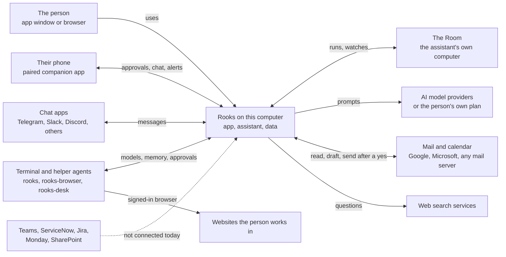
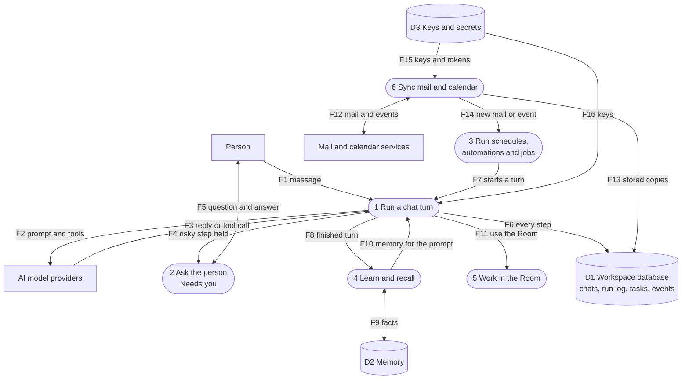
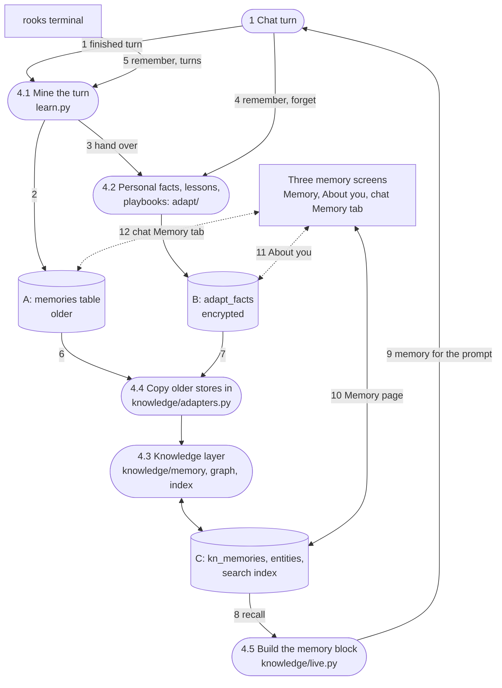

# Rooks: how it is built

An architecture map of the Rooks repository for the owner. It covers what the parts are, how information moves between them, where data and secrets are kept, what could be cleaned up, and what a workplace team would miss today.

**Source.** A read-only survey of branch `main` at commit `81125e1` on 8 November 2026. Sections a to i describe `main` as it was at that commit. The branch `cleanup/workplace` (stacked on `phase-1a/terminal-safety`) carries out the cleanup in section g and updates this document as it goes; where a part listed below has since been removed or moved, the cleanup notes in section g say so.

**A caveat on dates.** The whole repository was imported in one commit on 6 November 2026. A "last changed" date therefore only separates files touched since 7 or 8 November from the rest. It says nothing about how old or how alive a file really is. Status in this document comes from what imports what, what the screens call, and what the tests cover.

**Words used here.**

- *The app*: the Rooks program on the person's computer. It is a web page shown in a desktop window (or in a browser) with a Python server behind it. In the code it is still often called "Workbench" or "AI Workspace".
- *The assistant*: the AI inside the app. One assistant serves every channel: the app, the terminal, the phone, chat apps and schedules.
- *Run log*: one table (`actions`) where every model call, tool call, approval and outbound connection is written down.
- *Needs you*: the one inbox of everything that is waiting for the person to say yes or no.
- *The Room*: the assistant's own computer on this machine (a small Linux guest, a private desktop, or a private folder and shell). The app always says which one it really is.
- *Bridge*: a door that lets the terminal and helper programs use the app's models, memory and approvals.
- *MCP*: a common standard for plugging extra tools into AI assistants. Rooks can both offer tools this way and use other people's tools this way.
- *DFD*: a data flow diagram. Rounded boxes are processes (things that do work), cylinders are stores (where data rests), plain boxes are people or outside services. Arrows are numbered so the tables can describe them.

---

## a. What Rooks is

Rooks is a personal AI assistant that a person runs on their own computer, not in someone else's cloud. It is an app window with chat, mail, calendar, tasks, files, memory and scheduled routines, plus three command line helpers: `rooks` (a coding agent in the terminal), `rooks-browser` (an agent that uses a web browser) and `rooks-desk` (an agent that uses the computer's own apps). It can use almost any AI model: a paid key, a free provider, a model running on the computer, or the person's existing ChatGPT, Claude or Copilot plan. Anything risky (sending mail, running a command, letting a file leave the Room) is held until the person says yes, and every step is written to a run log they can read. A phone app pairs with the computer to answer approvals and chat on the move. Today it is built for one person on one computer; it is not yet a shared workplace service.

---

## b. Context diagram

Rooks and the outside world. The dashed arrow is a connection that does not exist yet.

What sits outside and how it is reached:

| Outside party | How Rooks reaches it | Notes |
|---|---|---|
| The person | The desktop app window, or a browser on the same computer, or a second browser paired with a code | One person per install |
| Phone | The phone app, paired once; over Wi-Fi, or through an encrypted relay mailbox | Not in any app store yet |
| AI model providers | Direct web calls with the person's key, a model on the computer, or the person's own Claude Code, Codex or Copilot program | Every call is in the run log |
| Mail and calendar | Google and Microsoft through their own sign-in; any other provider through standard mail protocols and app passwords; Apple Mail on a Mac | Calendars also from shared calendar links |
| Chat apps | Telegram, Slack, Discord, Matrix, Signal, WhatsApp and email as chat | Only listed people get answers |
| Websites | The browser helper, signed in once in its own browser profile | Used by the Sites feature |
| Web search | Brave, Tavily or a self-hosted search server | Key stored encrypted |
| Teams, ServiceNow, Monday, SharePoint | Not connected | Jira, Asana and Trello: read-only import into the Team board |

---

## c. Level 1 data flow diagram

The six main jobs the app does, the three stores they share, and the main flows. Phone and chat apps are drawn in section d.5.

| Flow | What moves | How |
|---|---|---|
| F1 | The person's message and any attachments | From the chat page; the reply streams back word by word |
| F2 | The prompt, the list of tools, earlier messages | A web call to the chosen provider, or a run of the person's own Claude Code, Codex or Copilot program |
| F3 | The answer, or a request to use a tool | Streamed back; the model choice ("Auto") picks fast or strong models and falls back when one is out of quota |
| F4 | A tool call that changes something outside (send, run, delete, pay) | Written to the run log as "waiting" |
| F5 | "May I do this?" and the person's yes or no | Shown in Needs you in the app, the phone, the terminal or by voice; the first answer wins |
| F6 | Each model call, tool call, approval and outbound connection | One row per step in the run log (`actions` table) |
| F7 | A scheduled prompt, an automation, a background job | Background loops in the app start a normal assistant turn |
| F8 | The finished conversation turn | After each turn, facts and reusable skills are mined |
| F9 | Facts, people, projects, links between them | Three separate memory stores today (see d.4) |
| F10 | A short block of what the assistant knows, sized to fit | Added to the next prompt |
| F11 | Start, run a command, click, type, take a picture, save a point | The `use_room` tool |
| F12 | Messages, drafts, sends, calendar events | Google and Microsoft through their own sign-in; others through standard mail and calendar protocols |
| F13 | Calendar events, mail account details, drafts | Calendar synced every 15 minutes |
| F14 | "A new mail arrived", "a meeting is near" | Triggers for automations |
| F15 | Sign-in tokens for mail and calendar | Decrypted only when needed |
| F16 | Provider keys | Decrypted only when needed; never written to logs |

---

## d. Level 2 data flow diagrams

### d.1 A chat turn with an approval

The person asks the assistant to send an email. The model wants to use the "send mail" tool, which is held until the person agrees, then checked afterwards.

Notes:

- The same loop serves every channel: the app, the terminal (`rooks talk`), the phone, Telegram, schedules and coworkers.
- If the prompt is too long, the loop compacts older messages and tries again (`compression.py`); the reply shows a "compacted" note.
- If the app restarts in the middle of a turn, the cut-off turn gets a note and the next turn says it resumed (`restart.py`).
- Receipts check that a change really exists (for example that the sent mail is in the sent folder). Claim checks compare the final answer with the receipts so the assistant cannot claim work it did not do.
- The approval can be answered in the app's Needs you sheet, on the paired phone, by voice, or from the terminal. It is answered exactly once.

### d.2 A scheduled routine

A morning routine ("plan my day") runs at 8:00, or an automation fires when a matching mail arrives.

Notes:

- Schedules run one at a time, in the workspace's time zone.
- The same idea is created in four places today: Automations (schedules and triggers), Teach (a playbook each morning), Coworkers (scheduled jobs for AI coworkers) and the Company page (agents working a task queue). They write to different tables.
- Budget checks in `usage.py` pause an agent before it overspends.

### d.3 The Room: terminal, files and browser

The Room is the assistant's own computer. The person watches it, steps in, and decides whether any file may leave it.

Notes:

- The Room only shows a screen when a real display exists. Its status always names the screen, the pointer, how isolated it is, and a plain label.
- There is no browser inside the Room yet. Today the browser is a separate helper program (`rooks-browser`) reached through `browser_proxy.py`, and the Browser page shows its steps and screenshots rather than a page the person can click in. A Room browser is planned (task 49) and is being built on another branch.
- The app also has its own Terminal page (`terminal_pty.py`), a shell on the person's own computer, separate from the Room's terminals.

### d.4 Memory and learning

What the assistant learns after each turn, and where it keeps it. Three stores hold the same kind of fact today.

Notes:

- The three screens read three different stores: the Memory page reads C, About you reads B, and the chat's Memory tab reads A.
- Sensitive text in B and C is encrypted with a data key that is itself protected by the app's secret (or the computer's keychain on the desktop build). The search index uses scrambled words so it can be searched without storing plain text.
- Skills are separate: skills from GitHub pass a security gate (`skills_hub.py`, `skill_scan.py`) and run in a sandbox (`skill_sandbox.py`).
- A daily backup copies the whole database, still encrypted (`knowledge/backup.py`).

### d.5 Phone and chat channels

How the phone, the Mac notch app and chat apps reach the same assistant.

Notes:

- Three separate ways for a phone or another app to reach this computer exist: device tokens (`mobile.py`), sealed envelopes (`phonelink.py`) and companion tokens (`companion.py`).
- Slack and Discord keep a live connection open; Matrix polls; Signal needs a separate signal service the person runs; WhatsApp needs a public address for its webhook, which a home computer usually does not have.
- Messages to other people are drafts first; only the person sends them. Team-lead messages to staff go through a separate outbox (`team/outbox.py`) with the same rule.
- There is no Microsoft Teams channel.

---

## e. Component map

Status words: **live** (used and reachable), **half built** (exists but a part is missing or unused), **duplicate** (another module does the same job), **dead** (nothing uses it). Line counts are approximate.

### e.1 The app's server (`workbench/backend/app`, about 32,600 lines, 777 tests)

**Wiring and health**

| Module | What it does | Status |
|---|---|---|
| main.py | Builds the server, runs upgrades, starts 14 background loops, mounts every route and the web page | live |
| config.py | Settings and defaults: data folder, app secret, add-on addresses, desktop flags | live |
| db.py | The database file, the 31 core tables, settings helpers (schema version 4) | live |
| health.py | Health checks on request, and the list of background loops | live |
| restart.py | Tells the truth about restarts: cut-off turns get a note, the next turn says resumed | live |

**Chat and models**

| Module | What it does | Status |
|---|---|---|
| assistant.py | The one agent loop for every channel: prompt with memory, 60 tools, approvals, receipts, compaction | live |
| assistant_api.py | Routes for chat, conversations, approvals, runs, memories, skills, schedules, inbox, usage, Company | live |
| api.py | One large file of routes: sign-in and lock, desktop session, providers and keys, notes, tasks, calendars, mail, research | live (should be split) |
| llm.py | Model calls for the rest of the app, each logged and priced | live |
| adapters.py | One class per provider type, plus running the person's own Claude Code, Codex or Copilot | live |
| router.py | "Auto" model choice: fast or strong model, quotas, cool-downs, fallback | live |
| catalog.py | Model facts (context size, price, vision) from a bundled list, refreshed daily | live |
| catalog_build.py | A build tool that makes the bundled model list; not used when the app runs | live (tool) |
| compression.py | Summaries of long chats that no longer fit | live |
| tool_results.py | Keeps long tool results so the model can read the rest later | live |
| attachments.py | Chat images and documents from the app, Telegram and the terminal | live |
| usage.py | Token and cost counts; budget checks that pause agents | live |
| siwc.py | Use a ChatGPT plan without an API key | live |
| plan_signin.py | Install and sign in to Claude Code, Codex or Copilot from the app | live |
| local_agents.py | Starts the browser helper when needed | live |
| finetune.py | Training sets from chats and hosted fine-tuning jobs | live (Advanced) |
| openapi.py | Signed-in listing of the routes | live |

**Approvals, Needs you and the run log**

| Module | What it does | Status |
|---|---|---|
| actions.py | The run log: every action, model call, approval and outbound connection | live |
| needs_you.py | One inbox of everything waiting on the person, answered once | live |
| presence.py | What the assistant is doing now, and the one poll the screen uses | live |
| receipts.py | Proves a change exists; checks claims against proof | live |
| goals.py | Goal mode: keeps taking turns until an objective is met | live |
| push.py | Phone notifications for approvals and finished runs | live |
| companion.py | Live view of every agent with approvals from the notch app or phone | half built (no web page uses it) |
| companion/hooks/ | Hook script and installer for Claude Code, Codex, Gemini and Cursor | live (developer only) |

**Memory and learning**

| Module | What it does | Status |
|---|---|---|
| learn.py | Mines memories and skills after each turn into the older memories table | duplicate |
| learn_hook.py | Tells the learning layer about Files and Sites work | live |
| adapt/knowledge.py | Encrypted personal facts with search (second memory store) | duplicate |
| adapt/playbooks.py | "Show me how": a recording becomes a playbook with a schedule | live |
| adapt/recorder.py | Recording interface; only the browser recorder is wired | half built |
| adapt/jobs.py | Notices habits and proposes routines | live |
| adapt/feedback.py | Thumbs, comments and edits become lessons | live |
| adapt/hooks.py, routes.py, store.py | The entry points, routes and eight tables of the learning layer | live |
| knowledge/memory.py | Memory tiers, sources, duplicates, conflicts, pinning, forgetting (third memory store) | duplicate |
| knowledge/graph.py | People, projects, files, sites and how they relate | live |
| knowledge/index.py | One search index over everything, on scrambled words | live |
| knowledge/recall.py | Mixed recall: search, graph, recency, pinning, within a size budget | live |
| knowledge/live.py | Keeps the graph current and builds the memory block for the prompt | live |
| knowledge/adapters.py | Copies older stores into the graph and index | live |
| knowledge/crypto.py | The data key for every encrypted column | live |
| knowledge/importers.py | Imports ChatGPT, Claude and Grok exports, Notion and Obsidian | live |
| knowledge/improve.py | Nightly improvement proposals, only when switched on | live |
| knowledge/backup.py | Daily database backups, restore, full export | live |
| knowledge/routes.py, mobile.py, text.py, schema.py | Routes, phone search, word handling, versioned upgrades | live |
| skills_hub.py | Skills from GitHub behind a security gate, trial run, audit | live |
| skill_scan.py | Offline security checks for skills | live |
| skill_sandbox.py | Runs skill scripts in isolation | live |
| skill_store.py | Suggested skills and connectors | live |

**Schedules, automations, coworkers and team**

| Module | What it does | Status |
|---|---|---|
| scheduler.py | Timed prompts, delivered to the inbox and optionally Telegram | live |
| front_door.py | The one main conversation; decides where results land | live |
| automations.py | "When X happens, do Y, ask me first" | live |
| jobs.py | Background jobs board with notices and questions | live |
| auto_tools.py | Assistant tools for automations, jobs and live documents | live |
| livedocs.py | Editable sheets, charts and documents inside replies | live |
| v02_api.py | Routes for automations, jobs and live documents (named after a branch) | live |
| company.py | AI agents in an org chart with budgets working a task queue | duplicate |
| starters.py | A proposed set of coworkers and schedules for a line of work | live |
| team/ (store, routes, engine, lead, replies, outbox, parse, sms, memory, loop, tools) | A team lead's board for human staff: tasks, plan, nudges by mail, Telegram or text, sub-agents | live |
| team/connect.py | Member updates and cloud task sync; the cloud is not set up | half built |
| team/trackers.py | Read-only import from Jira, Asana and Trello; no write-back | half built |
| teammates/ (store, routes, groups, computer, memory, hooks) | Several named AI assistants with personas, group chats, own folders | duplicate (fourth "coworker" idea) |
| teammates/vault.py | Logins, cards and addresses the assistant uses without seeing them | live |
| teammates/pages.py | Save a result as a page to edit and share | live |
| teammates/outbox.py | Every outgoing message is a draft until the person sends it | live |

**Mail, calendar and sign-in**

| Module | What it does | Status |
|---|---|---|
| mail.py | Read and send mail on any standard server; routes Google, Microsoft and Mac accounts | live |
| cloud_mail.py | Gmail and Microsoft mail and calendar for accounts connected with one sign-in | live (no tests) |
| connect.py | "Connect Google" and "Connect Microsoft" sign-in; tokens stored encrypted | live |
| oauth_clients.py | The public app identifiers used for that sign-in | live |
| mail_autodetect.py | Finds mail and calendar settings from an address | live |
| mac_mail.py | Mail through accounts already in Apple Mail | live (Mac only) |
| calendar_sync.py | Calendar links, CalDAV, Google and Microsoft calendars every 15 minutes | live |
| services.py | Shared operations for notes, tasks, events and agenda | live |

**The Room, computer and browser**

| Module | What it does | Status |
|---|---|---|
| room.py | The Room: status, start, stop, save points, reset, run, click, type, picture, hand-off | live |
| room_terminal.py | Real shells inside the Room, kept on the server, with private logs | live |
| room_files.py | Read-only listing of the Room folder | live |
| terminal_pty.py | The app's own Terminal page on the person's computer | live (to be hidden) |
| browser_proxy.py | Passes Browser page requests to the separate browser helper | live |
| desk_proxy.py | Passes Computer page requests to the computer-use helper | live |
| handoff.py | Notes the browser leaves for the Computer page | live |
| surfaces.py | Pairing codes so a second browser can reach this computer | live |

**Terminal link and tool servers**

| Module | What it does | Status |
|---|---|---|
| bridge.py | The model door for the terminal and helpers, plus Rooks Desk's send-mail | live |
| rooks_link.py | The terminal's link: memory, skills, search, approvals, packs, whole turns, hand-off codes | live |
| cli_agents.py, cli_agents_api.py | Coding jobs handed to rooks, Claude Code or Codex in a folder | live (developer only) |
| tools.py | A tool server for other chat programs (notes, tasks, calendar, mail search, drafts) | live (Advanced) |
| mcp_server.py | The same tools offered the MCP way | live (Advanced) |
| mcp_client.py, mcp_client_api.py | Rooks using the person's own MCP tool servers | live |

**Phone, voice and channels**

| Module | What it does | Status |
|---|---|---|
| mobile.py | Phone pairing, device tokens, home, approvals, chat | live |
| teammates/phonelink.py | End-to-end encrypted phone link through a relay | live (overlaps mobile.py) |
| telegram.py | Telegram chat with the same assistant | live |
| teammates/channels.py | Slack, Discord and Telegram settings and connections | live |
| teammates/more_channels.py | Matrix, Signal, WhatsApp and email as chat | half built (needs extra services) |
| anywhere.py | A global shortcut that asks about selected text in any app | live |
| voice.py | Dictation, spoken approvals and speech | live |
| meetings.py | Record or import a meeting; notes, decisions, tasks, follow-up draft | live |
| v02_mobile.py | Phone views of projects, history undo and checked answers | live |
| appearance.py | The chosen look, shared with phone and terminal | live |

**Files, work sites, projects and research**

| Module | What it does | Status |
|---|---|---|
| files.py | Reads any file into one shape with citations | live |
| analysis.py | The Files library: statistics, comparisons, new Excel, Word and PDF | live |
| compute.py | Runs data analysis code in a sandbox | live |
| helpers.py | Installs optional helper programs for Files | live |
| work_api.py, work_tools.py | Routes and assistant tools for Files and Sites | live |
| sites.py | Websites the person works in: signed in once, records, watches, actions with approval | live |
| projects.py | Projects that hold files, sites, chats, notes and people | live |
| history.py | One timeline of everything done, with undo and export | live |
| checked.py | Checked answers: lists sources and verifies claims | live |
| v02_hooks.py | Installs projects, history and checked answers (named after a branch) | live |
| research.py | Deep research: search, read pages, write a cited report | live |
| search.py | Web search through Brave, Tavily or a search server | live |
| media.py | Image generation saved to Files | live |
| packs/ (registry, routes, trade, trade_push, legal, study, store, tools, mobile_routes, ai) | Optional Trade, Legal and Study bundles; Trade pushes to ServiceM8 and Xero | live (to be hidden) |

**Security and secrets**

| Module | What it does | Status |
|---|---|---|
| security.py | Sign-in cookie, passwords, encryption, signed tokens, route guards | live |
| redact.py | Removes keys from every log line and error | live |
| egress.py | Records every outbound connection; shown on the Privacy page | live |
| keychain.py | Provider keys in the computer's keychain on the desktop build | live |
| account.py | Sign-in to a Rooks cloud service and paid plan checks; the cloud does not exist in this build | half built |
| features_v02.py | Which plan each feature belongs to | live |

### e.2 The screens (`workbench/frontend/src`)

67 route patterns, of which 4 are on the top bar (Chat, Room, Jobs, Settings), 12 in its menus (Day, Memory, Library), 31 only in the More sheet, and 6 with no place in the navigation. Every one of the 455 server paths the screens call exists on the server.

| Part | What it does | Status |
|---|---|---|
| pages/registry.ts | The one list of pages and where each appears | live |
| App.tsx, api.ts | Starts the app, sign-in, mounts routes; the client that talks to the server | live |
| shell/ | Top bar, presence line, side Stage, phone dock, More sheet, the one status poll | live |
| pages/Assistant.tsx, chat/ | The chat page: thread, composer, result cards with undo, model and mode chips | live |
| chat/tabs/SkillsTab.tsx | An older skills editor no route can open | dead |
| room/ | The Room page: terminal, screen, files and save-point windows; compact Room on the Stage | live |
| needs/ | The Needs you sheet | live |
| stage/surfaces.tsx | How the side Stage draws the Room, a browser job or a computer job | live |
| memory/ | The Memory page: facts, people, projects, conflicts, tidy up, backups and imports | live |
| memory/Improved.tsx | A "What I improved" card that nothing shows | dead |
| teammates/ | Teammates, Channels, Groups, Pages and Vault pages | live |
| team/ | The human team lead's board, plan, tracker settings, outbox | live |
| v02/ | Jobs board, job notifications, live sheets and charts, trigger builder | live |
| Day pages | Mail, Calendar, Tasks, Home | live |
| Memory pages | Skills, About you, Teach | live |
| Library pages | Files, Notes, Documents, Sites, Projects | live |
| Workspace pages | Automations, Research, Meetings, Talk, Coworkers, Packs, Browser and Computer (only when the helpers run) | live |
| pages/Code.tsx | Coding jobs plus copies of the Terminal, Browser and Computer pages as tabs | duplicate |
| pages/TerminalPage.tsx, terminalHost.tsx | A real shell in the app window | live (to be hidden) |
| pages/Customize.tsx | A page of tiles that only link to other pages | duplicate |
| pages/Company.tsx | AI agents in an org chart (Advanced) | live |
| Settings pages | Settings, Connect, Models, Voice, Appearance, Plan, About, Privacy, Phone | live |
| Advanced pages | History, Run log, Insights, Status, Compare, Fine-tune, Extra tools | live |
| Welcome, Auth, AskBar | First run, sign-in, the floating ask bar | live |
| Beside.tsx | An older side-by-side picker that the Stage now builds on | half built |
| Palette.tsx | The command menu (Ctrl or Cmd + K) | live |
| ui/, lib/, motion/, voice/, packs/, learn/ and helpers | Shared building blocks | live |

### e.3 The terminal, helpers and outer shells

| Part | What it does | Status |
|---|---|---|
| rooks-code (`rooks`) | Terminal coding agent: loop, file and command tools, full-screen terminal, Room and Needs you commands, shared memory and approvals, `rooks talk` | live |
| rooks-code redact.py, theme.py | Copies of the app's rules, kept in step by tests (theme has no test) | duplicate (on purpose) |
| rooks-browser | Browser agent using the person's Chrome or Edge; serves the Browser page, Sites and recordings | live |
| rooks-browser/app | An Electron browser preview with an "Ask Rooks" panel; nothing ships or starts it | half built |
| rooks-desk | Computer use on the person's own apps, with approvals, a kill switch and an on-screen frame | live |
| rooks-desk llm.py, mcp_client.py | Copies of other modules that have drifted apart | duplicate |
| rooks-try | The Room driver: Linux guest, private desktop, or private folder and shell | live |
| desktop/src-tauri, desktop/sidecar | The installable desktop app (version 1.0.6): starts the server, signs the window in, tray, shortcut | live |
| desktop/src-tauri sidecars.rs (three rows) | Placeholder rows for helpers "coming later" | dead |
| desktop/launcher | The `ai-workspace` command and the installer behind the install scripts | live |
| desktop/rooks-native | A second desktop window drawn without a web view (version 0.4.0) | half built |
| mobile/ | The phone app (Expo); not in any app store | live |
| companion/macos | The Mac notch app; built by hand, no automatic checks | half built |
| vscode-extension | Ask the assistant from VS Code; not on the Marketplace | half built |

### e.4 Older and supporting material at the top level

| Part | What it does | Status |
|---|---|---|
| assistant/ and the `hermes` link | A kit to run a different, third-party assistant (Hermes) on a server | live (separate product) |
| browser-agent/ | The old Docker browser agent that rooks-browser replaced | duplicate |
| cli/ws | A second, older terminal chat client, shipped with each release | live (duplicates `rooks talk`) |
| cli-launcher/ | A Docker service to run Claude Code or Codex; nothing in the app calls it | half built |
| paperclip/, searxng/ | Settings for optional server add-ons | live |
| marketing/launch-posts.md | Draft launch posts with claims that are no longer true | dead |
| screenshots/ | 347 old screenshots, 40 MB | dead |
| scripts/test-all.sh | Runs every local test suite (not all the suites the online checks run) | live |
| scripts/ci, security-scan.sh, hooks | Online check helpers, secret and dependency scans | live |
| scripts/hermes-config.sh, paperclip-invite.sh, sync-opencode-config.sh | First-run helpers for the server add-ons | live |
| scripts/write-oauth-clients.py, setup-sign-in.sh | Register the Google and Microsoft sign-in apps for releases | live |
| scripts/release/package.sh | Builds a source zip; nothing calls it | unknown |
| scripts/check-theme-contrast.py | Colour contrast check that nothing runs | half built |
| scripts/audit/ | Regenerates old evidence pages | half built |
| scripts/test_vertical_slice.py | A test tied to one developer's folder path | dead |
| install.sh, install.ps1 | One-command install for one person, no Docker | live |
| install-server.sh, setup.sh, docker-compose files, .env.example | The Docker server install with add-ons | live (secondary) |
| .github/workflows | Checks, desktop builds, releases, server image, Mac window check, native window build | live |
| README.md, QUICKSTART.md, SECURITY.md, THIRD_PARTY_NOTICES.md, docs/ | Guides, design records, decisions, security model | live (some stale, see section i) |
| PROGRESS-desktop.md, ai-workspace-audit-report.md, docs/AUDIT.md and other dated reports | Snapshots from earlier branches | dead (history) |

---

## f. Stores and where secrets live

### f.1 Where data rests

| Store | Where | What it holds | Secrets |
|---|---|---|---|
| The workspace database | One file, `workbench.db`, in the app's data folder | Chats, the run log, provider connections, settings, notes, tasks, events, mail accounts, skills, schedules, inbox, devices; plus many more feature tables that modules create on first use | Yes, encrypted |
| Memory and knowledge tables | Same file | Graph, memories, search index; sensitive columns encrypted with a data key | Yes, encrypted |
| App secret and tool key | Two files in the data folder, readable only by the owner, unless set in the environment | The root key that encrypts every stored key and signs sessions; the key for the tool servers | Yes |
| Computer keychain | macOS Keychain, Windows Credential Manager or the Linux secret service (desktop build) | Provider keys, site keys, vault items, the memory data key, as references; moved into the database on first start | Yes |
| Files library | `files/` in the data folder | Uploaded and generated documents | No (but may be sensitive) |
| Attachments and phone uploads | `attachments/`, `mobile_uploads/` | Chat images and documents | No |
| Installed skills | `skills/` | Skill folders pinned to a version | No |
| Teammate folders | `teammates/<id>/` | Each teammate's files and its own browser profile | Yes (browser cookies) |
| Backups | `backups/` | Daily database copies (still encrypted) and export zips | Yes |
| Fine-tune, speech models, coding runs | `finetune/`, `whisper/`, `cli-runs/` | Training files, local speech models, coding logs | No |
| Browser helper profiles | rooks-browser's own folder | Signed-in browser sessions for work sites, screenshots, downloads | Yes |
| Computer helper folder | rooks-desk's own folder | A screenshot per step, shell output, deleted-file trash | Yes |
| The Room folder | `~/.ai-workspace/try-room` | Files made in the Room, up to 20 save points, private terminal logs | No |
| Project folder `.rooks/` | Inside each project the terminal works in | Run receipts, undo copies, background job logs | No |
| Old server add-on volumes | Docker volumes (server install only) | Browser jobs, Hermes, Paperclip, Open WebUI data | Yes |

### f.2 Where secrets live, and the weak spots

| Secret | Kept in | Protection |
|---|---|---|
| App secret (the root key) | A file readable only by the owner, or the keychain on the desktop build | Everything else hangs off this |
| Provider keys, mail sign-in tokens, channel bot tokens, tracker tokens, search keys | The database, encrypted with the app secret; or keychain references | Never written to logs (`redact.py`) |
| Memory data key | Keychain, or wrapped by the app secret | Protects every encrypted memory column |
| Vault logins and cards | Database, encrypted, or keychain | The assistant fills forms without seeing them; filling needs a yes |
| Bridge key for the terminal (`app.json`) | A file in the person's settings folder, owner-only, removed when the app quits | Any program running as the person can read it, so it can never answer an approval |
| Terminal access token | Only its fingerprint is stored in the database | Needed for Room and Needs you commands from the terminal |
| Terminal provider keys (`rooks-keys.json`) | Owner-only file in the settings folder | Plain on disk |
| Companion token (`companion.json`) | Owner-only file in the home folder | Plain on disk |
| Phone device token and keys | The phone's secure storage | Device-only |
| Paired browser token | The browser's local storage | **Weak spot:** any script on the page could read it |
| Typed terminal history (`rooks-history`) | Settings folder | **Weak spot:** every prompt typed, not cleaned of secrets |
| Docker server `.env` | The server checkout, owner-only | All server secrets in one file |
| Release signing and sign-in app values | GitHub repository secrets | Used only by release builds |

---

## g. Cleanup proposal

This is a proposal. Nothing is deleted by this document. "Hide behind Advanced" means keep the code and the tests but take the page out of the normal menus.

### g.1 Delete

| Path | Why | Risk |
|---|---|---|
| screenshots/ | 347 old branch screenshots (40 MB). No document shows them; `.gitignore` already says this folder should not be tracked. Every install downloads them. | Low. Fix one pointer in `docs/motion.md`. |
| marketing/launch-posts.md | Claims that are false today ("mail never sends", "no shell tool", "350 MB"). Publishing it would break the "never fake results" rule. | Low. Rewrite launch copy from the current README if needed. |
| PROGRESS-desktop.md | Log for an old branch; says the licence is MIT, but it is now proprietary. | Low. |
| ai-workspace-audit-report.md | A 4 November snapshot that cites a script that does not exist. | Low. Move to a history folder if the record matters. |
| scripts/test_vertical_slice.py | Hard-wired to one developer's folder, so it cannot run anywhere else. | None. |
| frontend chat/tabs/SkillsTab.tsx | No route can open it; the Skills page replaced it. | Low. Update one text check in the tests. |
| frontend memory/Improved.tsx | Nothing shows it. | Low. Decide whether Home should show the card instead. |
| frontend pages/Customize.tsx | Every tile links to another page; Settings and the More sheet already do this. | Low. Point the old `/connect` link at Settings. |
| desktop sidecars.rs placeholder rows | Three "coming soon" rows; one points at the old browser agent. | Low. |
| api.py `/api/trade` routes | No screen calls them. | Low. |
| browser-agent/ | The old Docker browser agent; rooks-browser replaced it and speaks the same job language. Two browser agents with different safety rules. | Medium. The Docker "browser" add-on, setup script, Paperclip and Hermes settings, README, one check job and one terminal test refer to it. Replace the Docker service with rooks-browser first. |
| cli-launcher/ (and its two Docker add-ons and settings) | Nothing in the app reads its address; running the person's own Claude Code or Codex already works another way. | Medium. It is the only plan-based path for a Docker server with no local programs. Ask the owner first. |
| frontend pages/Code.tsx | Coding is for developers; the page also repeats the Terminal, Browser and Computer pages. | Medium. The terminal keeps coding jobs; update the chat's plan and build modes and two tests. |

**Totals for the "Delete" table** (files only; partial deletions inside other files are not counted):

| Group | Files | Text lines | Size |
|---|---|---|---|
| Safe now (screenshots, marketing, two root reports, one script, three screens) | 354 | 638 (plus 1,036 lines of notes and scripts inside screenshots/) | 40.5 MB |
| Needs a step first (browser-agent, cli-launcher, Code page) | 34 | 2,468 | 0.1 MB |
| **All** | **388** | **3,106 (4,142 with the screenshot notes)** | **about 40.6 MB** |

Counted from `main` with git. 40.5 MB is 40,516,226 bytes; screenshots/ alone is 40,476,156 bytes (328 pictures, 5 videos, 3 animations and a few notes).

### g.2 Merge

| Path | Into | Why | Risk |
|---|---|---|---|
| learn.py (memories) + adapt/knowledge.py (adapt_facts) + knowledge/memory.py (kn_memories) | One memory store in knowledge/ | Three stores for one idea; one Memory page, one "forget" | Medium. Existing users need a one-time move; two tests check the old path. |
| Memory page + About you + chat Memory tab | The Memory page | Three screens over three stores | Medium. Only after the stores are merged. |
| company.py + starters.py + teammates/ + team/ | Two ideas: Coworkers (AI) and People (humans) | Four overlapping models of "others who work here"; a workplace pitch cannot show four pages for this | High. Needs a product decision first; the team area alone has 15 tables. |
| Tasks, project items, team tasks, agent tasks, jobs | One task list with an owner (me, a coworker, a person) and a project | Five task tables; a Planner or Jira user expects one list | High. Tools, phone routes, meetings, team and Company each write their own table. |
| browser_proxy.py, local_agents.py, handoff.py | room.py (the Room browser) | One built-in browser the person and the assistant share | High. Sites and the recorder use the helper's browser profile and must move with it. |
| mobile.py + teammates/phonelink.py + companion.py | One phone module | Three ways a phone reaches this computer | High. The phone app and notch app need the exact same routes; keep routes, merge code. |
| telegram.py | teammates/channels.py | Telegram is set up there but run from a separate file | Medium. 12 test files mention Telegram. |
| Tables created on first use in about 30 modules (including the terminal hand-off table) | knowledge/schema.py upgrades | Schema in one place, with versions | Low to medium. Upgrade order must be tested. |
| Four status routes no screen calls | One health answer | Simpler Status page | Low. |
| Notes, Documents and Teammate pages | Library, Documents | Three document lists | Medium. Teammate pages have share links that notes lack. |
| Talk page and Voice settings | Chat (a voice mode) and Settings | Voice lives in three places | Low. |
| Research page | A chat mode | A question-to-report flow belongs in chat | Low. |
| Models page | Settings, Models | Two places manage providers | Low. |
| Beside.tsx | shell/StageHost | An older hand-made screen list beside the Stage | Medium. |
| rooks-desk and rooks-browser llm.py, rooks-desk mcp_client.py | One shared copy, synced by a script | Copies 27 to 60 lines apart with no test | Medium. Each tool installs separately. |
| desktop/rooks-native | One desktop app | A second desktop window that repeats the web screens | High. Decide which window is "the app" first. |
| cli/ws | rooks-code | A second terminal client with different names and settings | Medium. Shipped in releases; deprecate for one release first. |
| Old audits and evidence (docs/AUDIT.md, PHASE0-GATE, ROOKS-FINISH-REPORT, docs/evidence, docs/night, scripts/audit) | docs/history/ | Snapshots mixed in with current guides | Low. Fix links from design record 0004. |

### g.3 Hide behind Advanced

| Path | Why | Risk |
|---|---|---|
| Terminal page (terminal_pty.py stays; the Room's terminals use its helpers) | Workplace buyers do not need a shell in the app | Low |
| Coding jobs, companion hooks, "Continue in terminal", terminal access | Developer features | Medium. Keep running, just unlisted; the terminal must still match the app. |
| Tool servers for other chat programs, and links to Open WebUI, Paperclip, Hermes | For other AI front ends, not a workplace team | Low |
| Fine-tune, Compare, Run log, Insights, Status, Extra tools | Developer tools (already Advanced) | Low |
| Trade, Legal and Study packs | Aimed at sole traders and students | Medium. 21 tests; the terminal and phone also show packs. |
| account.py and paid-plan checks | Points at a cloud that does not exist; shows paywalls for nothing | Medium. Turn plan checks off by default. |
| assistant/ (Hermes), paperclip/, searxng/, Docker add-ons | The server line is secondary | Low |
| goals routes | Goals are set from chat; no screen calls the routes | Low |
| rooks-browser/app (Electron preview) | A third browser surface nothing starts | Low. Pick one browser surface before investing more. |
| companion/macos | One commit, built by hand, Mac only | Low. Fix the server's description of it. |

### g.4 Rename

| Path | New name | Why | Risk |
|---|---|---|---|
| api.py | auth_api, providers_api, day_api, mail_api, research_api | 1,188 lines mixing eight purposes | Low if the routes keep their paths |
| v02_api.py, v02_hooks.py, v02_mobile.py, features_v02.py | automations_api, projects_hooks, projects_mobile, plan_tiers | Named after a branch, not a purpose | Low |
| catalog_build.py | scripts/build_model_catalog.py | A build tool inside the running program | Low |
| Home page | "Today", first in the Day menu | Called Home but hidden in More | Low |
| "AI Workspace" on screens (sign-in error page, Connect results, mail app-password name, Apple Mail, "AI Workspace Cloud", backup readme, calendar exports, Computer page, desktop app name, search server name, default workspace name), and the wake phrase "hey workspace" | Rooks | The product is Rooks; mixed names confuse people | Medium. Renaming the desktop app makes the computer treat it as a new app (permissions, keychain); the Google and Microsoft sign-in apps are registered under the old name. |
| Stale status lines in design records 0003 to 0006, the native app plan, decision record 0001, docs/README "100 reasons", README sections, SECURITY.md versions table | Corrected text | See section i | None |

### g.5 Keep as they are

| Path | Why |
|---|---|
| Internal names: `aiworkspace://` links, `~/.ai-workspace`, `~/.config/ai-workspace`, the `ai-workspace` command, `AI_WORKSPACE_*` settings, Docker project and image names | Renaming breaks existing installs, links, data folders and Docker volumes unless a move is written |
| The Room, Needs you, presence, restart, run log, receipts, security, redaction, outbound record, knowledge layer | The newest, best-tested and most distinctive parts |
| cloud_mail.py | The path every Google Workspace or Microsoft 365 customer takes; it needs a test suite against a fake service before any pitch |
| team/trackers.py | The seed of real Jira, Asana and Trello links; needs write-back |
| rooks-code (the terminal) | The Code page, `rooks talk`, hand-off and shared approvals depend on it; hide its screens instead |
| rooks-try display driver | A drawn terminal picture, only used when asked for by name, as the honesty rule requires |
| vscode-extension | Small and tested; fix its default address |
| scripts/check-theme-contrast.py, scripts/release/package.sh | Useful; run once, then add to checks or document |
| The paired-browser token in local storage | Needed for pairing; moving it to a safer cookie changes the pairing flow |

---

## h. What a workplace team would miss today

Ranked by how soon a workplace buyer would notice. Each line names the existing module the work would grow from.

| Rank | Missing | Today | Would extend |
|---|---|---|---|
| 1 | **Microsoft Teams**: chat with the assistant in Teams, post summaries to a channel, approve from a Teams card, read meeting transcripts | Nothing. Channels are Slack, Discord, Telegram, Matrix, Signal, WhatsApp and email. Meetings only take an uploaded recording. | `connect.py` and `cloud_mail.py` already sign in to Microsoft and call Microsoft Graph for mail and calendar: add Teams permissions there. A Teams channel beside Slack in `teammates/channels.py`. Approval cards from `needs_you.py`. Transcripts into `meetings.py`. |
| 2 | **More than one person**: shared workspace, roles, an admin, company sign-in (Entra ID, Google, Okta) | One person per computer by design. Local PIN or password. The Plan page advertises company sign-in on a Business tier that does not exist. | `security.py` (sign-in and route guards), `surfaces.py` (paired browsers), `account.py` (the unbuilt cloud). This is the largest change on this list. |
| 3 | **Tests for the Microsoft and Google mail path** | `cloud_mail.py` has no tests at all, even against a fake service | `cloud_mail.py`, with a fake-service suite like the existing ones for `connect.py` |
| 4 | **Microsoft 365 files and tasks**: OneDrive, SharePoint, Planner, To Do | Only Outlook mail and calendar | `cloud_mail.py` (Graph calls) and `connect.py` (permissions); files into `analysis.py` (Files library); tasks into `services.py` |
| 5 | **Jira and Asana that work both ways; Monday** | Read-only import of Jira, Asana and Trello into the Team board with a personal token; no Monday | `team/trackers.py` (add write-back, comments, Monday); show the items in the personal Tasks list |
| 6 | **ServiceNow** | Nothing in any part of the code | A new connector beside `team/trackers.py`; tickets into the jobs board (`jobs.py`) and approvals through `needs_you.py`. Today only the Sites feature could read it by screen. |
| 7 | **Google Workspace beyond Gmail and Calendar**: Drive, Docs, Sheets, Chat, Meet | Gmail and Google Calendar only | `connect.py` (Google permissions) and `cloud_mail.py`; Google Chat as a channel in `teammates/channels.py` |
| 8 | **A built-in browser the person and the assistant share** for web apps without a connector | A separate browser helper with steps and screenshots; Sites scrape records after one sign-in | `room.py` (the planned Room browser), taking over `browser_proxy.py`, `local_agents.py` and the browser parts of `sites.py` |
| 9 | **Company tenant sign-in approval** | The app uses its own shipped sign-in identifiers, registered under the old name; tenants that block user consent need an admin, and there is no admin flow | `oauth_clients.py`, `connect.py` |
| 10 | **Audit records an IT team would accept**: export, retention, a manager's view | The run log and outbound record are strong but stay on each computer | `actions.py`, `egress.py`, `history.py` (already exports CSV and PDF) |
| 11 | **One place for people and one task list** | Four coworker models and five task tables | `team/` and `teammates/` (see the merges in g.2) |
| 12 | **Managed install**: signed installers, packages IT can push, central policy | Per-person installs from GitHub; preview builds not signed | `desktop/launcher`, the desktop build workflow, `desktop/src-tauri` |
| 13 | **Zoho** beyond mail | Zoho Mail through app passwords only | `mail_autodetect.py` already knows Zoho; CRM, Desk and Projects would sit beside `team/trackers.py` |
| 14 | **Developer surfaces out of the way** | Terminal and Code in the Workspace menu; Plan and Build coding modes in chat | `pages/registry.ts` (one list decides where every page appears) |
| 15 | **Phone app, notch app and VS Code add-on that IT can hand out** | Phone app runs through a developer tool; the others are built by hand | `mobile/`, `companion/macos`, `vscode-extension` |
| 16 | **Workplace pricing and copy** | Prices in Australian dollars, Trade, Legal and Study packs, small-business examples | `features_v02.py`, `pages/Plan.tsx`, packs |

---

## i. Contradictions between the documents and the code

Plain list, most visible first.

1. **"Mail is draft-only, it never sends."** Said in `docs/README.md` (points 16 and 57) and in the marketing posts. The code sends mail after a yes (`mail.py`, `cloud_mail.py`, Rooks Desk's send-mail).
2. **The Claude Code add-on "not built yet".** Said in the README. Running the person's own Claude Code, Codex or Copilot works today (`adapters.py`), and `docs/CLAUDE-CODE.md` describes it.
3. **The product name.** README is titled Rooks and the server's default name is Rooks, but the desktop app is named "AI Workspace", the Docker setup's default name is "AI Workspace", sign-in and mail screens say "AI Workspace", and the wake phrase is "hey workspace". The quick start guide is titled "AI Workspace".
4. **Supported versions.** `SECURITY.md` lists `integration/v0.3`; the install line is `main` at 1.0.6. It also promises a signed updater, while the README says signing and updates are off until the keys exist.
5. **Licence.** `PROGRESS-desktop.md` says MIT; the licence file says proprietary.
6. **Design records say "not merged".** Records 0003 (Workroom), 0004 (Coworkers) and 0005 (Rooks Browser app) say not merged or not shipped; all are on `main`. Record 0006 still says "design record" though the Room desk is built.
7. **"Nothing in this document is built."** Said in `docs/native-app-plan.md`; `desktop/rooks-native` exists and has its own build.
8. **Which window is the app.** Decision record 0001 says the app window is the desktop (Tauri) app; the installers now skip that app by default ("that release is the old app") and a second native window exists. No newer decision record replaces it.
9. **Marketing size and features.** The posts say a 350 MB container and "no shell tool"; the README measures 248 MB, and there is a Terminal page and the Room.
10. **The old browser agent.** rooks-browser replaced `browser-agent/`, but the README's "Browser agent" section, the Docker setup, Paperclip and Hermes settings still describe or start the old one, and a desktop placeholder row points at its folder.
11. **Claude Code and Codex addresses.** The setup script writes them and `config.py` defines them; nothing reads them.
12. **"Runs every suite."** `AGENTS.md` says `scripts/test-all.sh` runs every suite and must pass before pushing; it skips the old browser agent, `cli/tests`, the CLI launcher, the VS Code add-on and the phone app, which the online checks run. "All passed." locally covers less than the online checks.
13. **"The terminal, the browser and the app must match."** `AGENTS.md` sets this rule, but there are two terminal clients (`rooks` and `cli/ws`) with different settings files and names, and two browser agents with different safety rules.
14. **Where the database schema lives.** `AGENTS.md` names `db.py` as the database and its version; tables are also created on first use in about 30 other modules, including the terminal hand-off table.
15. **The companion.** `companion.py` says the web app uses it and mentions a `companion/desktop` folder; no screen calls it and that folder does not exist.
16. **Screenshots.** `.gitignore` says `/screenshots/` is for throwaway captures and should not be tracked; 347 files are tracked.
17. **Company sign-in.** The Plan page offers company sign-in on a Business tier; there is no such sign-in, and the cloud that would sell the tier is not set up.
18. **Feature guides written as unmerged branches.** `docs/teammates.md`, `docs/packs.md` and `docs/v02-anywhere-voice.md` describe their features as living on feature branches; they are on `main`.
19. **docs/AUDIT.md** says "nothing in this repository is named Rook".
20. **VS Code add-on address.** It defaults to the Docker server's port; the desktop app picks a random port each time.
21. **"Add-ons are Docker-only".** The README lists the browser agent among Docker-only add-ons; the desktop app starts rooks-browser itself.
22. **Teams in the team area.** The word "teams" in `team/connect.py` means the app's own unbuilt cloud team sync, not Microsoft Teams; easy to misread in a pitch.

---

*Written from four read-only surveys (server, screens, terminal and shells, top-level material) of `main` at `81125e1`, 8 November 2026. File counts and sizes in section g were measured with git on that commit. Where a survey marked something "unknown", it is left unknown here.*
